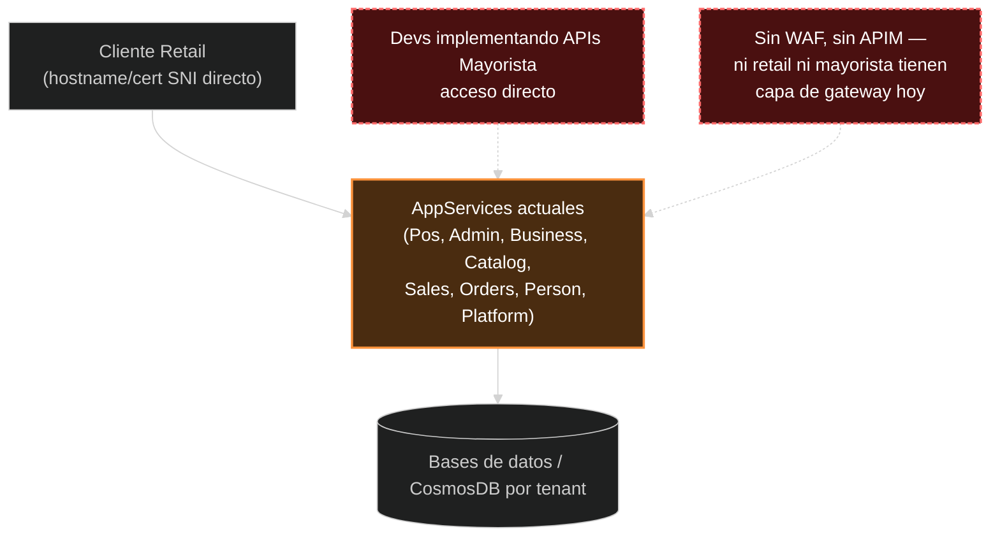
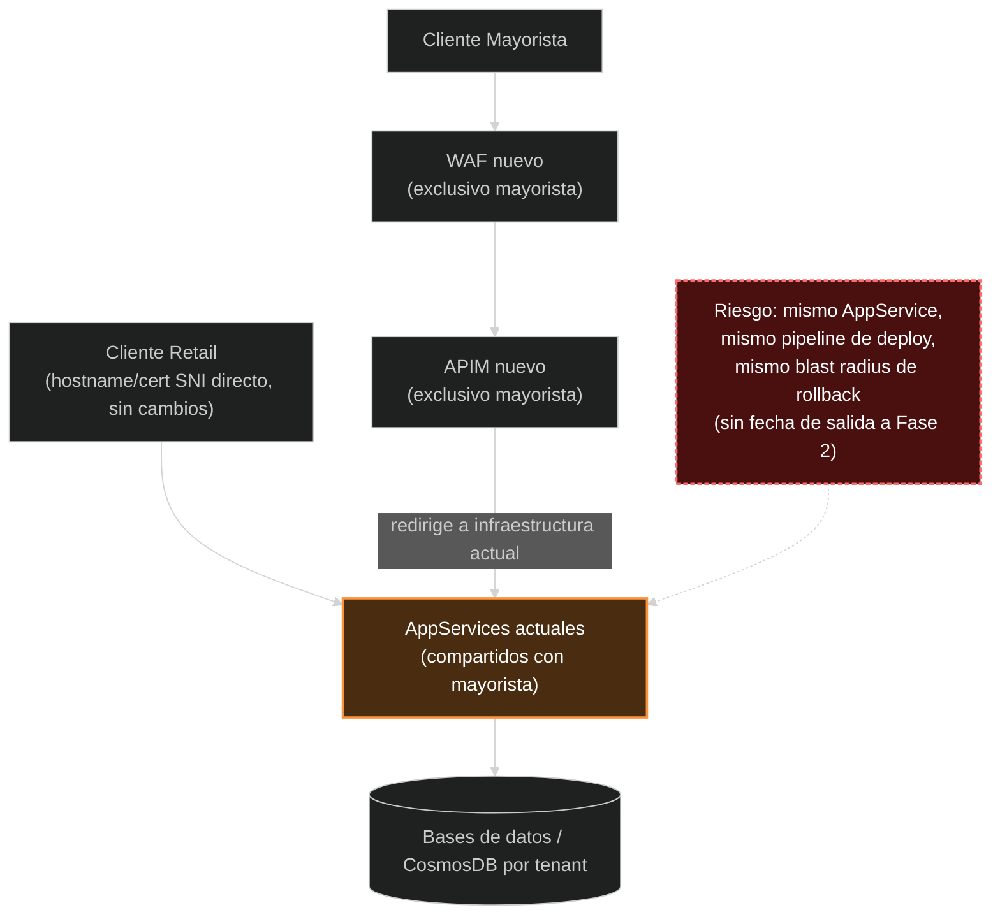
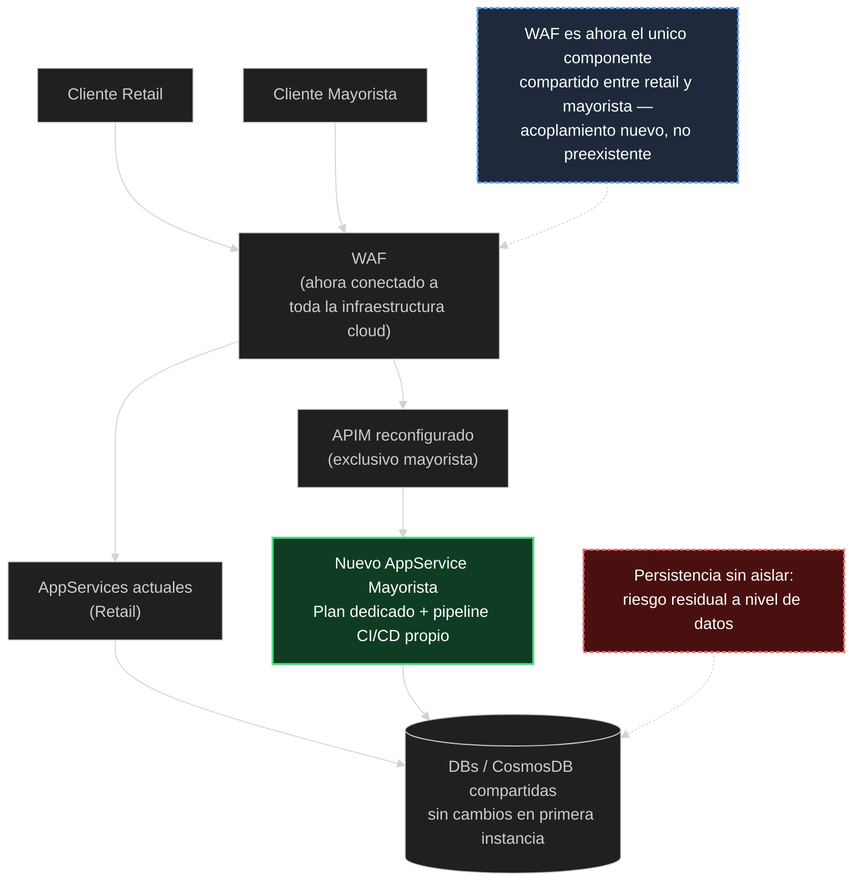

# Servicio Mayorista — Propuesta de Arquitectura: Guía Técnica para Desarrollo

**Ticket Jira:** GITIN-1938
**Audiencia:** equipo de desarrollo del nuevo servicio mayorista
**Alcance:** estado actual de la infraestructura, propuesta de desacople en dos fases, y qué implica cada etapa para el código y el proceso de deploy

**Estado de este documento:** la Etapa 0 descripta abajo es el estado real y confirmado hoy. Fase 1 y Fase 2 son una **propuesta en evaluación** (GITIN-1938), todavía **no aprobada como plan de ejecución** — dentro de cada fase, los puntos ya decididos están marcados explícitamente como "Confirmado"; el resto (incluida la secuencia y el alcance completo de las fases) sigue sujeto a discusión y puede cambiar antes de implementarse.

---

## Resumen

El nuevo servicio para el cliente mayorista se está desarrollando hoy dentro del mismo App Service Plan compartido que usan los servicios retail (Pos, Admin, Business, Catalog, Sales, Orders, Person, Platform). Esto no es una decisión de arquitectura definitiva — es el punto de partida (Etapa 0) de una propuesta de desacople en dos fases, todavía en evaluación. Este documento describe qué existe hoy, qué propone cambiar cada fase, y qué implicaciones técnicas concretas tiene cada estado para el equipo que está construyendo el servicio.

---

## Etapa 0 — Estado actual

**Qué es cierto hoy, técnicamente:**

- Los endpoints mayoristas se desarrollan dentro del mismo App Service Plan que retail. **Es el mismo deployment unit** — un deploy fallido o un rollback disparado por código mayorista actúa sobre el mismo AppService que sirve tráfico retail en producción.
- **No hay WAF ni APIM delante de nada** — ni de retail ni de los endpoints mayoristas en desarrollo. Ningún tráfico pasa hoy por una capa de protección L7 (reglas OWASP) ni por governance de API gateway (rate limiting, subscription keys). Esto es así para retail también, no es una brecha exclusiva del mayorista.
- No hay pipeline de CI/CD separado. Un build/deploy del código mayorista corre por el mismo pipeline que retail.
- La persistencia (DB/CosmosDB) es la misma que usa retail — sin aislamiento a nivel de datos (ver sección "Persistencia" más abajo).

**Implicación práctica para desarrollo:**

- **Validación de entrada es responsabilidad exclusiva de la aplicación.** No hay WAF filtrando requests maliciosos — cualquier endpoint expuesto debe validar/sanitizar su propio input como si estuviera directamente en Internet, porque efectivamente lo está.
- **Todo deploy es de alto riesgo para retail.** Hasta que exista separación de pipeline (Fase 2), cualquier cambio que rompa el build o falle un health check puede disparar un rollback que afecta AppServices retail. Extremar la disciplina de testing antes de cada deploy; considerar deployment slots si es necesario desplegar con frecuencia antes de que la separación de pipeline esté lista.
- **No asumir rate limiting ni autenticación de gateway.** Cualquier control de acceso, throttling o cuota debe implementarse en el código de la aplicación — no hay APIM ni WAF haciendo ese trabajo todavía.

---

## Fase 1 (propuesta, no aprobada) — WAF + APIM nuevos, exclusivos del mayorista

**Qué cambiaría:** se provisionarían un WAF y una APIM nuevos, exclusivos para el cliente mayorista — no compartidos con retail. El tráfico del cliente mayorista entraría por WAF→APIM, y la APIM redirigiría ese tráfico al mismo AppService compartido que ya usa retail.

**Qué NO cambiaría:** el cómputo. El código mayorista seguiría desplegándose en el mismo AppService Plan que retail. Todo el riesgo de acoplamiento de deploy descripto en Etapa 0 seguiría vigente en Fase 1 — la única diferencia sería que el cliente mayorista tendría un punto de entrada dedicado con protección WAF y governance de APIM, mientras que retail seguiría sin ninguna de las dos.

**Implicación práctica para desarrollo, si esta fase se aprueba:**

- La disciplina de testing/deploy de Etapa 0 seguiría aplicando sin cambios — Fase 1 no resolvería el riesgo de rollback compartido.
- El tráfico mayorista entraría por APIM — cualquier policy de rate limiting, transformación de request/response o versionado que se necesite podría configurarse ahí (governance a nivel gateway, no en código de aplicación).
- La propuesta recibida no define fecha para pasar de Fase 1 a Fase 2 — no asumir que la separación de cómputo sería inminente aun si esta fase se aprueba.

---

## Fase 2 (propuesta, no aprobada — algunos puntos ya confirmados) — AppService dedicado + pipeline propio

**Confirmado (2026-08-25):**

- **App Service Plan dedicado.** El nuevo AppService mayorista se aprovisionará sobre un Plan propio, no compartido con retail. El riesgo de deploy/rollback cruzado quedará resuelto a nivel de cómputo cuando esto se implemente.
- **Pipeline de CI/CD propio.** Build y release del servicio mayorista correrán en un pipeline separado del de retail — un build roto de un lado no bloqueará ni revertirá releases del otro.
- **Auth0 dedicado.** El nuevo set de apps mayorista usará su propia aplicación Auth0, sin compartir con el tenant/Organizations Auth0 que usa retail hoy. **No implementar contra el flujo de tenant resolution existente de retail** (`organizations` en App Configuration, `TenantHandlingMiddleware`) — es un mecanismo distinto y no aplicará al mayorista.
- **Persistencia sin cambios (decisión deliberada, no un olvido).** En una primera instancia, el servicio mayorista usa la misma capa de datos compartida que retail — sin DB/CosmosDB dedicada. Ver sección siguiente, es el punto más importante para desarrollo.

**Pendiente de decisión:** si el WAF se extiende para cubrir también retail ("conectado a toda la infraestructura cloud", tal como está escrita la propuesta) o se mantiene exclusivo del mayorista. No afecta al código de la aplicación directamente, pero si se extiende, un incidente de configuración de WAF podría bloquear tráfico mayorista por una regla pensada para retail, o viceversa — vale la pena que el equipo lo tenga presente al definir reglas de WAF específicas del mayorista si llega a implementarse.

---

## Persistencia — el punto que más afecta al código

Esto es lo más relevante de este documento para quien esté escribiendo el servicio mayorista: **la base de datos NO se aísla en esta primera etapa.** El servicio mayorista lee y escribe sobre la misma infraestructura de datos que retail usa hoy (mismo elastic pool / misma capacidad de CosmosDB, según corresponda).

Esto es el patrón conocido como **"shared database"** — cómputo e identidad ya están aislados, pero los datos no. Implicaciones concretas para el código:

- **Cualquier migración de esquema debe evaluarse contra el impacto en retail.** Si el mayorista necesita tablas o campos nuevos, agregarlos de forma aditiva y no bloqueante; nunca asumir que se puede modificar una tabla existente sin verificar qué lee/escribe retail sobre ella.
- **Consultas pesadas o bulk writes del lado mayorista pueden degradar el rendimiento de retail** por contención de capacidad (DTU/vCore en SQL, RU/s en CosmosDB) — no hay aislamiento de capacidad entre ambos. Evitar operaciones de alto volumen sin coordinar con SRE, especialmente en los primeros meses de tráfico real.
- **No hay rollback de código que deshaga un incidente de datos.** Un bug que corrompa o bloquee filas compartidas no se revierte desplegando una versión anterior del servicio — el daño ya está en la base de datos.
- Este es un riesgo aceptado deliberadamente para lanzar más rápido, no una limitación técnica permanente — hay un criterio de revisión pendiente en el ticket para migrar a persistencia dedicada si el volumen de tráfico mayorista lo justifica.

---

## Checklist rápido para desarrollo

| Tema | Estado hoy | Qué implica |
|---|---|---|
| Cómputo (AppService) | Compartido con retail (Etapa 0/Fase 1); dedicado en Fase 2 | Todo deploy es de alto riesgo hasta Fase 2 — extremar testing |
| WAF / protección L7 | No existe todavía | La app debe validar/sanitizar su propio input |
| APIM / governance de API | No existe hasta Fase 1 (luego exclusivo mayorista) | No asumir rate limiting ni auth de gateway antes de Fase 1 |
| CI/CD | Pipeline compartido con retail | Un build roto puede bloquear releases de retail — cuidado especial en cada PR |
| Identidad (Auth0) | Dedicado, confirmado | Implementar contra la app Auth0 propia del mayorista, no la de retail |
| Persistencia (DB/CosmosDB) | Compartida, sin aislar (decisión deliberada) | Migraciones aditivas, cuidado con queries pesadas, coordinar con SRE |
| Hosting (Linux/Windows) | Pendiente de confirmar | Recomendado Linux — Windows tiene una limitación de logging conocida (GSFC-LOG-1) en AppServices .NET de este proyecto |

---

## Referencias

Detalle completo de hallazgos, riesgos y acciones propuestas en el ticket Jira **GITIN-1938**.
