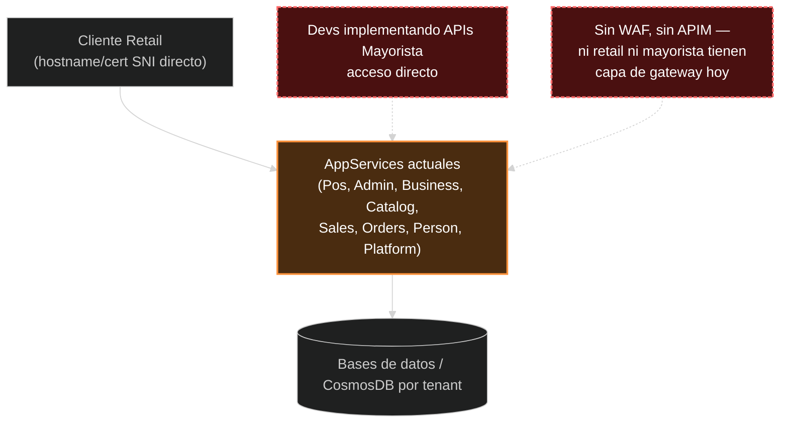
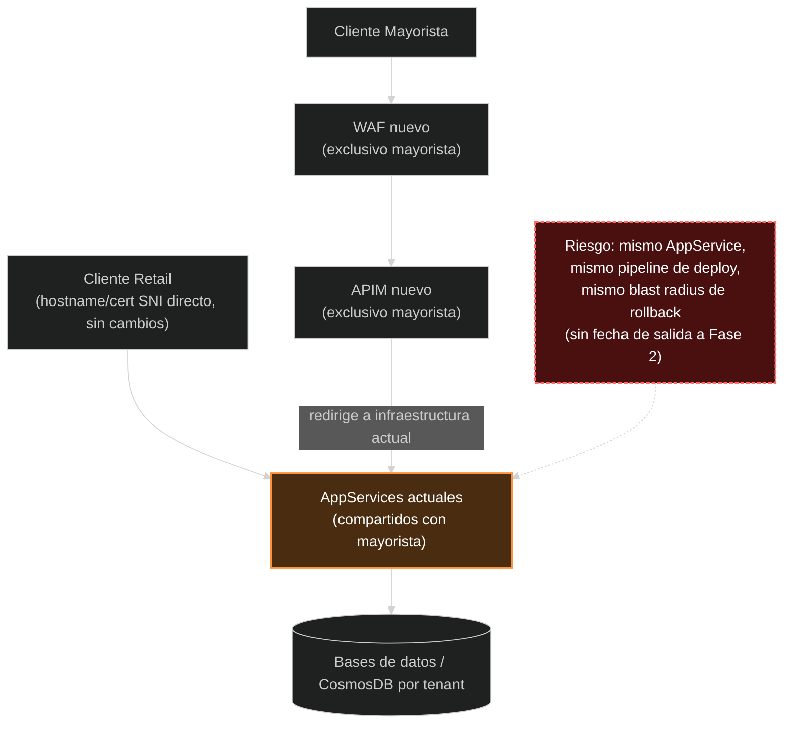
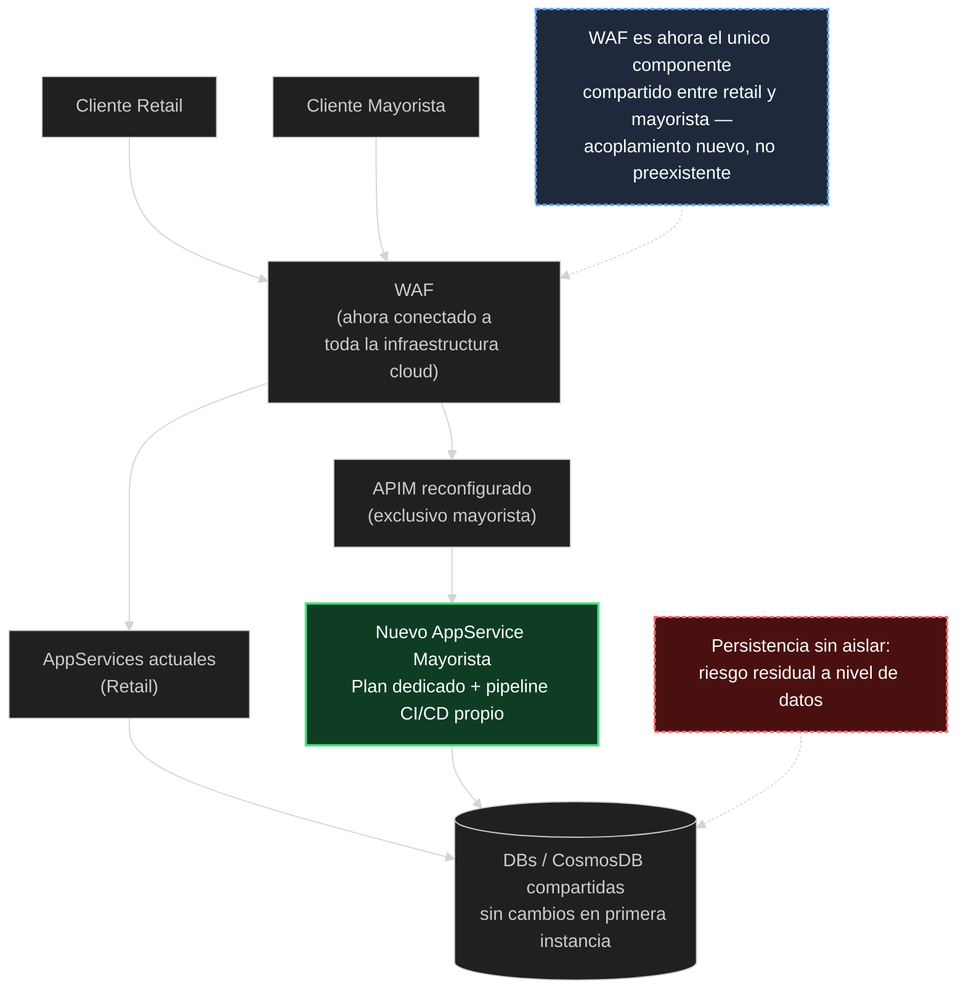
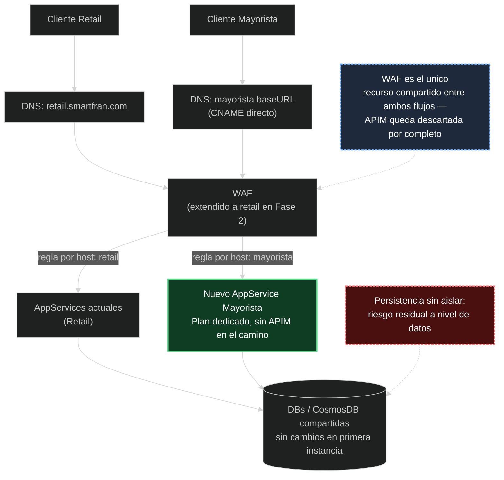

# Desacoplar infraestructura del nuevo servicio mayorista de los AppServices retail — GITIN-1938

**Tags:** `SmartCloud`, `Azure`, `SRE`

## Resumen

Un nuevo servicio para un cliente mayorista, con reglas de negocio potencialmente distintas a las de retail (POS/Admin), se está desarrollando actualmente dentro del mismo App Service Plan compartido que usa retail — no como una decisión de diseño para una fase futura, sino como desarrollo activo ya en curso (Etapa 0). Esto expone a los servicios retail (Pos, Admin, Business, Catalog, Sales, Orders, Person, Platform) al riesgo de que un bug o despliegue fallido del servicio mayorista dispare un rollback que impacte producción de retail, dado que ambos comparten la misma unidad de despliegue. Además, hoy ni retail ni los endpoints mayoristas en desarrollo tienen WAF ni APIM delante — ambos se acceden directamente, sin capa de protección ni governance a nivel de gateway. Se recibió una propuesta de arquitectura (dos fases) que introduce WAF+APIM como infraestructura nueva y busca desacoplar el AppService del mayorista; esta revisión identifica brechas en esa propuesta y define las acciones necesarias antes y durante su implementación.

## Tabla resumen

| Campo | Valor |
|---|---|
| Ticket Jira | GITIN-1938 |
| ID alerta | N/A — revisión de arquitectura proactiva, no alerta |
| Sistema | SmartFran Cloud — AppServices retail compartidos (`SmartFran-Cloud-{Pos,Admin,Business,Catalog,Sales,Orders,Person,Platform}-PRO`), Azure APIM, WAF |
| Severidad | Media-Alta — riesgo de acoplamiento de despliegue activo hoy, sin incidente confirmado aún |
| Detectado | 2026-08-25 |
| Resuelto | Pendiente |
| Responsable | Pendiente de asignar |

## Causa raíz

El nuevo servicio mayorista se está implementando dentro del mismo App Service Plan y, presumiblemente, del mismo pipeline de CI/CD que usa retail hoy (Etapa 0), sin ningún mecanismo de aislamiento de despliegue. En ese esquema, cualquier despliegue fallido o rollback disparado por código del servicio mayorista actúa sobre la misma unidad de despliegue que retail, sin separación de blast radius. Actualmente no existe WAF ni APIM delante de ningún AppService retail ni de los endpoints mayoristas en desarrollo — ambos se acceden directamente (mismo patrón de hostname/certificado SNI documentado para retail). La propuesta de arquitectura recibida introduce WAF+APIM como infraestructura nueva: en Fase 1, exclusiva para el cliente mayorista (ruteo vía WAF→APIM→AppServices actuales, redirigiendo tráfico a la infraestructura existente; retail no se menciona como parte de este camino); en Fase 2, el WAF pasa a estar "conectado a toda la infraestructura cloud" según el texto de la propuesta — es decir, retail se sumaría por primera vez al WAF compartido — mientras que la APIM queda reconfigurada apuntando exclusivamente al nuevo AppService dedicado del mayorista, nunca frente a retail. La propuesta no define fecha de salida de Etapa 0, no separa el pipeline de CI/CD, y deja sin resolver si extender el WAF a retail (Fase 2) es la decisión correcta o si conviene mantenerlo exclusivo del mayorista.

## Diagramas — Etapa 0 / Fase 1 / Fase 2

## Opciones de aislamiento WAF/APIM

WAF y APIM no son infraestructura preexistente compartida — son componentes nuevos que esta misma propuesta introduce. La APIM, tal como está descripta en la propuesta original, ya queda exclusiva del mayorista en ambas fases (nunca frente a retail) — eso no es un eje de decisión real. El eje real es distinto: **la Fase 2, tal como está escrita, conecta el WAF a "toda la infraestructura cloud"**, es decir, retail se sumaría por primera vez a un WAF compartido con el mayorista. Eso le da a retail protección WAF que hoy no tiene, a cambio de introducir el primer punto de acoplamiento nuevo entre ambos. La alternativa es mantener el WAF exclusivo del mayorista y dejar sin resolver — como tema aparte — que retail no tiene protección WAF hoy.

**Opción A — Propuesta tal como está escrita: WAF extendido a retail en Fase 2, APIM exclusiva del mayorista**

| Pros | Contras |
|---|---|
| Retail obtiene protección WAF por primera vez, sin costo adicional de un WAF propio | Introduce el primer componente compartido entre retail y mayorista (WAF) — un incidente de configuración de WAF podría afectar a ambos |
| APIM nunca queda frente a retail — rate limiting/quota, governance de subscription-key y facade/versionado quedan disponibles para el mayorista sin afectar a retail | Costo de infraestructura de la instancia de APIM (uso exclusivo mayorista) |
| Es la propuesta ya redactada — menor esfuerzo de negociación/rediseño | Otra capa de configuración que puede volverse fuente de incidentes (precedente ya existente de incidentes WAF/APIM en el proyecto) |

**Opción B — DNS directo al nuevo AppService (sin APIM), WAF también extendido a retail en Fase 2**

| Pros | Contras |
|---|---|
| Sin costo de infraestructura de APIM — nunca se provisiona | Rate limiting solo parcial: WAF soporta reglas de rate-limit por IP/geo (spike-arrest volumétrico), pero no por identidad de cliente/subscription-key — un consumidor mayorista específico no puede limitarse individualmente si comparte IP/NAT con otros. Sin quota por cliente a nivel gateway — habría que construirlo en la app o aceptar el gap |
| Topología más simple, menos piezas, más rápido de levantar (DNS + certificado + regla de host en WAF) | Sin governance de subscription-key — alta/baja de sub-clientes mayoristas se vuelve tarea manual/de código |
| Retail obtiene protección WAF por primera vez, igual que en la Opción A | Sin capa de facade/versionado para el mayorista — el baseURL queda atado por DNS directamente al AppService; cambios de topología futuros son un cambio de DNS visible para el cliente |
| Menos recursos que SRE debe operar/monitorear a futuro (nunca hay APIM que mantener) | Sin analítica de uso por consumidor a nivel gateway (App Insights cubre parcialmente, no por subscription-key) |
| | Depende de que el WAF en uso soporte ruteo por host a un backend distinto sin impactar la configuración de retail — sin confirmar |
| | Mismo acoplamiento nuevo que la Opción A: WAF pasa a ser compartido entre retail y mayorista |

**Opción C — WAF exclusivo del mayorista, nunca extendido a retail**

Sin acoplamiento nuevo entre retail y mayorista en ningún componente — aislamiento completo desde el día uno. A cambio, retail sigue sin protección WAF, sin que este ticket lo resuelva (queda como brecha de seguridad aparte, probablemente fuera de alcance de GITIN-1938). Independiente de si se usa APIM (dedicada) o DNS directo para el mayorista.

## Hallazgos

| # | Hallazgo | Riesgo |
|---|---|---|
| H1 | Desarrollo activo de nuevas APIs mayoristas dentro del App Service Plan compartido de retail (Etapa 0) — confirmado, no es un riesgo futuro. Confirmado además: en esta etapa no hay WAF ni APIM delante de nada — ni de los endpoints mayoristas en desarrollo ni del tráfico retail actual, ambos se acceden directamente. Es una exposición de seguridad distinta al riesgo de acoplamiento de despliegue (sin capa de protección WAF ni governance de APIM para ningún tráfico hoy), no solo el mismo riesgo más temprano. | Alto |
| H2 | El pipeline de CI/CD no está separado entre el servicio mayorista y retail — un build/deploy fallido del lado mayorista puede bloquear o revertir un release de retail. | Alto |
| H3 | La Fase 1 propuesta no mitiga el riesgo de acoplamiento de cómputo — introduce WAF+APIM nuevos, exclusivos del cliente mayorista, pero el AppService de destino sigue siendo el mismo AppService Plan 100% compartido con retail; el riesgo de rollback cruzado de H1 permanece sin cambios en Fase 1. | Alto |
| H4 | WAF y APIM no son infraestructura preexistente compartida — son componentes nuevos que la propuesta introduce. La APIM queda exclusiva del mayorista en ambas fases (nunca frente a retail), eso no es un riesgo. El riesgo real: la Fase 2, tal como está redactada, conecta el WAF a "toda la infraestructura cloud" — retail se sumaría por primera vez a un WAF compartido con el mayorista, introduciendo el primer punto de acoplamiento nuevo entre ambos (a cambio de que retail obtenga protección WAF que hoy no tiene). Ver sección "Opciones de aislamiento WAF/APIM": (A) propuesta tal como está — WAF extendido a retail, APIM dedicada; (B) DNS directo sin APIM, WAF también extendido a retail; (C) WAF exclusivo del mayorista, sin extender a retail — aislamiento completo, pero la falta de protección WAF de retail queda sin resolver. En cualquier opción que incluya WAF y/o APIM, el costo de infraestructura debe contemplar dos sets completos (PROD + no-productivo), no uno solo. | Medio |
| H5 | No hay fecha ni criterio de salida definido para Etapa 0 → Fase 1, ni para Fase 1 → Fase 2. | Medio |
| H6 | Confirmado: el nuevo set de apps mayorista usará su propia aplicación Auth0 dedicada, sin compartirla con el tenant/Organizations Auth0 actual de SmartFran Cloud (retail) — resuelve el acoplamiento en la capa de identidad. Confirmado además: en una primera instancia la persistencia se maneja tal cual está — sin DB/CosmosDB dedicada, reutilizando la capa de datos compartida existente. Esto es el patrón conocido como "shared database" (o "monolito distribuido a nivel de datos"): aunque cómputo (H7) e identidad ya están aislados, una única base de datos compartida reintroduce el mismo acoplamiento que la separación de AppService buscaba eliminar — contención de capacidad (DTU/vCore o RU/s), bloqueos/corrupción de datos compartidos, acoplamiento de esquema entre migraciones de mayorista y retail, y backup/PITR conjunto. Ningún rollback a nivel de código deshace un incidente de datos a este nivel. | Alto |
| H7 | Confirmado: el nuevo AppService se aprovisionará sobre un App Service Plan dedicado, no compartido con retail — resuelve el aislamiento de cómputo para cuando se implemente (Fase 2). No resuelve H2 (pipeline de CI/CD sin separar), H3 (cómputo de Etapa 0/Fase 1 sigue compartido) ni H4 (decisión pendiente sobre si el WAF se extiende a retail). | Bajo (resuelto) |

## Recursos afectados

| Recurso | Detalle |
|---|---|
| AppServices retail | `SmartFran-Cloud-{Pos,Admin,Business,Catalog,Sales,Orders,Person,Platform}-PRO` — App Service Plan compartido donde se está desarrollando el servicio mayorista (Etapa 0); actualmente sin WAF ni APIM delante |
| Azure APIM | No existe todavía — infraestructura nueva a provisionar por la propuesta, exclusiva del mayorista en ambas fases |
| WAF | No existe todavía — infraestructura nueva a provisionar por la propuesta; en Fase 2, según el texto recibido, pasaría a cubrir también retail |
| App Configuration | `SmartFran-Cloud-Settings-PRO` — contiene el arreglo `organizations` usado para resolución de tenant retail; pendiente definir si aplica al mayorista |
| Pipeline CI/CD | Pipeline actual de retail — sin separación respecto al desarrollo del servicio mayorista |

## Comandos ejecutados

Revisión basada principalmente en la propuesta de arquitectura recibida y en `cloud/docs/infrastructure.md`. Comandos ejecutados en `scripts.sh`:

| # | Comando / Script | Propósito |
|---|---|---|
| C1 | Chequeo pandoc/mmdc | Confirmar disponibilidad local de `pandoc` y `mermaid-cli` para exportar `dev-guide.md` a PDF/LaTeX con diagramas renderizados |

## Acciones propuestas

1. Definir y comunicar una fecha límite para pasar de Etapa 0 (desarrollo compartido) a Fase 1 (ruteo dedicado vía APIM) (SRE + Dev).
2. Evaluar detener el desarrollo directo de nuevos endpoints mayoristas dentro del App Service Plan compartido de retail; si Fase 2 no es inmediata, considerar deployment slots como mitigación intermedia de rollback (Dev).
3. Separar el pipeline de CI/CD del servicio mayorista del pipeline de retail, de forma que un build/deploy fallido de un lado no bloquee ni revierta releases del otro (SRE).
4. Decidir si el WAF se extiende a retail en Fase 2 (Opciones A/B, tal como está redactada la propuesta) o se mantiene exclusivo del mayorista (Opción C) — actualmente la propuesta original asume la extensión a retail sin que haya sido una decisión explícita (SRE + Dev).
   4a. Si se extiende el WAF a retail (Opción A o B): confirmar producto/tier de WAF a usar (Application Gateway WAF_v2, Front Door Premium, u otro — no confirmado en la documentación actual), y validar que un incidente de configuración de WAF compartido es un riesgo aceptable para retail a cambio de obtener protección WAF por primera vez (SRE).
   4b. Si se evalúa incluir APIM (Opción A): estimar el costo de infraestructura de la instancia, de uso exclusivo del mayorista (SRE). Si se evalúa DNS directo sin APIM (Opción B): confirmar que el WAF soporta ruteo por host/backend pool, y validar que el rate limiting solo por IP/geo (sin identidad de cliente/subscription-key) es aceptable para el cliente mayorista (SRE + Dev).
   4d. El costo estimado de APIM y WAF debe contemplar **dos sets completos**, no uno: uno para el ambiente PROD y otro para los ambientes no-productivos (DEV/STG/TEST, hoy en la suscripción Smart IT - Grido según `cloud/docs/infrastructure.md`) — necesarios para poder probar cambios de configuración de WAF/APIM antes de aplicarlos en PROD, mismo criterio que ya existe para los AppServices (SRE).
   4c. Si se elige la Opción C (WAF exclusivo del mayorista): registrar la falta de protección WAF de retail como brecha de seguridad separada, para seguimiento fuera de este ticket (SRE).
5. ~~Confirmar el modelo de resolución de tenant~~ — confirmado: Auth0 app dedicada, sin compartir con el tenant Auth0 de retail. ~~Confirmar si tendrá DB/CosmosDB dedicada~~ — confirmado: en una primera instancia sin cambios, persistencia compartida con la infraestructura actual. Este punto queda elevado a riesgo Alto (H6, patrón "shared database") — evaluar antes de que el volumen de tráfico mayorista sea significativo: monitorear contención de capacidad (DTU/vCore o RU/s) en la DB compartida, y definir criterio de migración a persistencia dedicada si el riesgo se materializa (Dev + SRE).
6. ~~Definir si el nuevo AppService usará un App Service Plan dedicado~~ — confirmado: Plan dedicado, no compartido con retail (SRE + Dev).
7. Confirmar hosting Linux (no Windows) para el nuevo AppService, para evitar heredar la limitación de logging ya conocida para AppServices Windows/.NET (GSFC-LOG-1, ver `cloud/docs/infrastructure.md`) (SRE).

## Hallazgos secundarios

- El documento de propuesta recibido (traducido con DeepL) presenta los diagramas de Fase 1 y Fase 2 en orden `Servicio Nuevo → APIM → WAF`, invertido respecto al flujo real de tráfico (cliente → WAF → APIM → backend). Probablemente un artefacto de formato/traducción, no una intención de diseño — vale la pena confirmarlo con el autor antes de que el documento circule más ampliamente.
