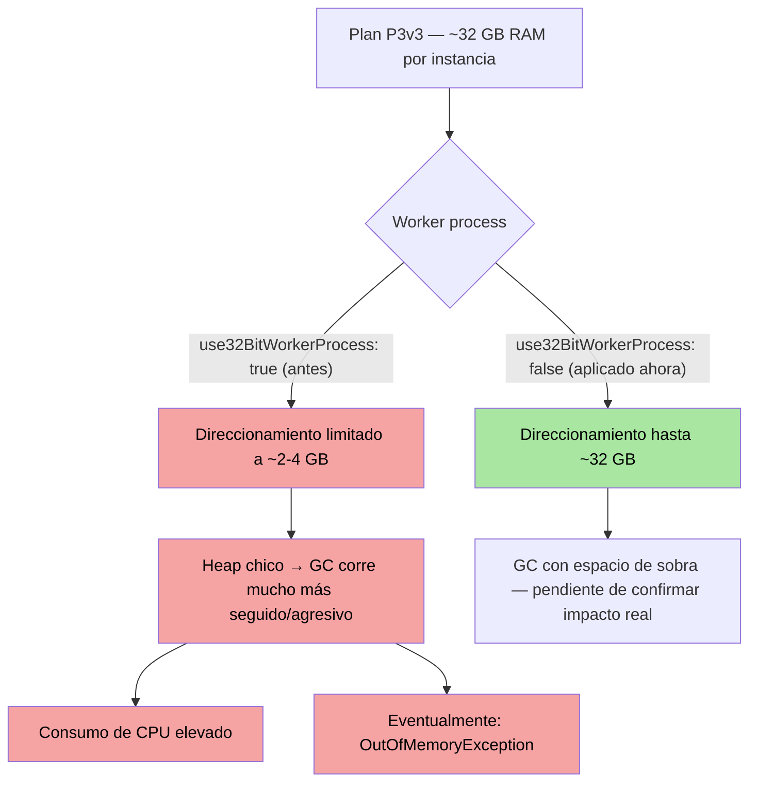
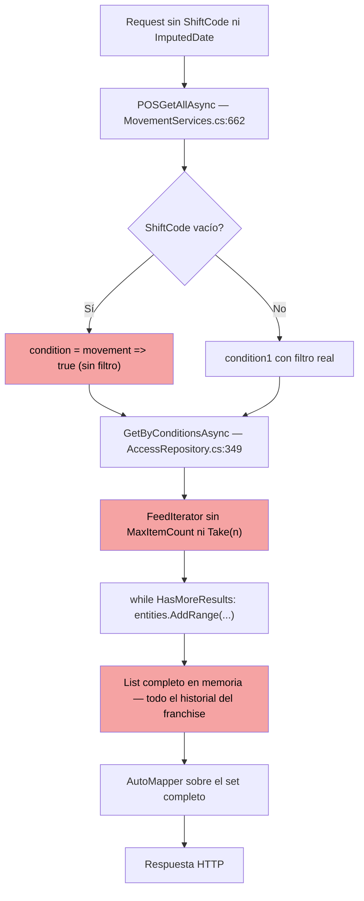

Para: Dev — SmartFran Cloud Sales
De: Dante Paniagua, SRE
Asunto: Sales — hallazgo técnico sobre las caídas por OOM (worker process 32 bits + posible bug de consulta sin límite)

Hola equipo,

Comparto dos hallazgos técnicos de la investigación de las caídas recurrentes de Sales por `System.OutOfMemoryException` (18 caídas en las últimas 48 horas, mismo patrón identificado a mediados de septiembre).

## Por qué hay OOM si el plan tiene memoria de sobra

Confirmamos en la configuración de App Service que `SmartFran-Cloud-Sales-PRO` corre su worker process en **modo 32 bits** (`use32BitWorkerProcess: true`), a pesar de estar en un plan P3v3 (~32 GB de RAM por instancia) y de correr .NET v10.0. Un proceso de 32 bits en Windows solo puede direccionar entre ~2 y 4 GB de memoria, independientemente de cuánta RAM tenga la VM — esto por sí solo alcanza para explicar que el proceso llegue a `OutOfMemoryException` mucho antes de acercarse al límite físico del plan. No hay ningún límite de memoria manual configurado como app setting (`WEBSITE_MEMORY_LIMIT_MB` u otro) — el techo real es el de direccionamiento de 32 bits, no una config explícita.

**Actualización: ya se aplicó el cambio a 64 bits** (`use32BitWorkerProcess: false`), confirmado en la configuración actual del App Service.

Esto también podría explicar los picos de CPU reportados, no solo el OOM: un proceso de 32 bits con un heap mucho más chico obliga al garbage collector a correr con mucha más frecuencia para no quedarse sin espacio — trabajo de GC que se ve como consumo de CPU. Si las consultas sin límite del punto siguiente generan objetos grandes (Large Object Heap), el efecto se agrava bajo el techo de 32 bits. Es una hipótesis razonable que conecta ambos síntomas, no algo que hayamos medido directamente (no tenemos datos de frecuencia de GC para confirmarlo).

**Estado del seguimiento post-cambio:** sin caídas nuevas en las ~3 horas posteriores al cambio (última caída registrada: 20/09 22:10 UTC). Todavía no es evidencia concluyente — durante el período activo de caídas ya hubo ventanas limpias de 12-14 horas sin ningún evento, así que un resultado confiable va a necesitar una ventana de monitoreo bastante más larga.



## Posible bug de código — consulta sin límite en Movement/POSGetAll

Encontramos un patrón de consulta sin límite que podría estar contribuyendo a la presión de memoria bajo carga, independientemente del punto anterior:

- `AccessRepository.GetByConditionsAsync` (repositorio base de Cosmos, `SmartFran.Cloud.Sales.Infrastructure/Repositories/Domain/CosmosSDK/AccessRepository.cs:349-374`) vacía el `FeedIterator` completo en una lista en memoria — sin `MaxItemCount`, sin `Take(n)`, sin ningún límite de resultados.
- `MovementServices.POSGetAllAsync` (`MovementServices.cs:662`) puede terminar llamando a este método sin filtro real: si `ShiftCode` viene vacío, la condición cae a `movement => true` (todo), y si además `ImputedDate` es null, la partition key queda reducida a `{FranchiseeCode}` — sin acotar por fecha tampoco.
- `MovementFilterCmd` (el modelo de request) no tiene ningún campo de paginación (`Skip`/`Take`/`PageSize`) — no es que no se use, no existe como opción.

En el tráfico real de las últimas 48 horas, `Movement/POSGetAll` tuvo 13.745 llamadas, con un máximo de 230.015 ms — justo en el techo de espera de 230 segundos de Azure — y ya había aparecido con errores 500 recurrentes en la investigación de mediados de septiembre (`cloud/events/20260915_sales-appservice-perf-report/`).

No confirmamos todavía que esta consulta puntual coincida con los horarios exactos de las 18 caídas — es la hipótesis más sólida que tenemos, no una causa confirmada.



`MovementFilterCmd` no tiene ningún campo de paginación — el diagrama muestra el peor caso (sin `ShiftCode` ni `ImputedDate`), pero incluso con `ShiftCode` presente, ese camino tampoco tiene un límite de resultados aguas abajo en `GetByConditionsAsync`.

`AccessRepository.cs:349-374` — el método base, sin cap de resultados:

```csharp
public async Task<IEnumerable<T>> GetByConditionsAsync(Expression<Func<T, bool>> condition, IList<string>? partitionKeys = null)
{
  try
  {
    List<T> entities = new List<T>();
    FeedIterator<T> setIterator = (partitionKeys == null || partitionKeys.Count == 0 || partitionKeys.Any(x => string.IsNullOrEmpty(x))) ?
      _container.GetItemLinqQueryable<T>()
      .Where(condition)
      .ToFeedIterator<T>():
      _container.GetItemLinqQueryable<T>(requestOptions: new QueryRequestOptions { PartitionKey = this.GetPartitionKey(partitionKeys)})
      .Where(condition)
      .ToFeedIterator<T>();        
    while (setIterator.HasMoreResults)
    {
      var response = await setIterator.ReadNextAsync();
      entities.AddRange(response.Resource);
    }

    setIterator.Dispose();
    return entities;
  }
  catch (Exception)
  {
    throw;
  }
}
```

`MovementServices.cs:662-696` — el caller que puede llegar sin filtro real:

```csharp
public async Task<IEnumerable<POSMovementView>> POSGetAllAsync(MovementFilterCmd movementFilterCmd)
{
  try
  {
    List<string> partitionKey = POSBuildPartitionKey(movementFilterCmd);

    Expression<Func<Movement, bool>> verdadero = movement => true;
    Expression<Func<Movement, bool>> condition2 = movement =>
      movement.MovementAssignment.Any(z => z.MovementFranchise.Select(y => y.FranchiseCode).Contains(movementFilterCmd.FranchiseCode));
    Expression<Func<Movement, bool>> condition1;
    if (movementFilterCmd.ImputedDate != null)
    {
      condition1 = movement =>
        (movement.ShiftData != null && movement.ShiftData.ShiftCode == movementFilterCmd.ShiftCode)
        || (movement.ShiftCode != null && movement.ShiftCode == movementFilterCmd.ShiftCode);
    }
    else
    {
      condition1 = movement =>
        ((movement.ShiftData != null && movement.ShiftData.ShiftCode == movementFilterCmd.ShiftCode)
        || (movement.ShiftCode != null && movement.ShiftCode == movementFilterCmd.ShiftCode))
        && (movement.POSCode == movementFilterCmd.POSCode);
    }

    var movement = await _movementRepository.GetByConditionsAsync((!string.IsNullOrEmpty(movementFilterCmd.ShiftCode)) ? condition1 : verdadero, partitionKey);
    List<POSMovementView> movementView = movement.Select(_mapper.Map<POSMovementView>).ToList();
    if (movementFilterCmd.FranchiseTimeZone is not null)
      movementView.ForEach(x => x.DateTimeUtc = x.DateTimeUtc.ToTimeZone(movementFilterCmd.FranchiseTimeZone));
    return movementView;
  }
  catch (Exception ex)
  {
    throw;
  }
}
```

Nota al margen: `condition2` se construye pero nunca se usa — parece código muerto o un filtro que se perdió en algún refactor, no afecta el problema principal pero llamó la atención.

Cualquier feedback o corrección bienvenida antes de proponer un cambio concreto.

Saludos,
Dante
