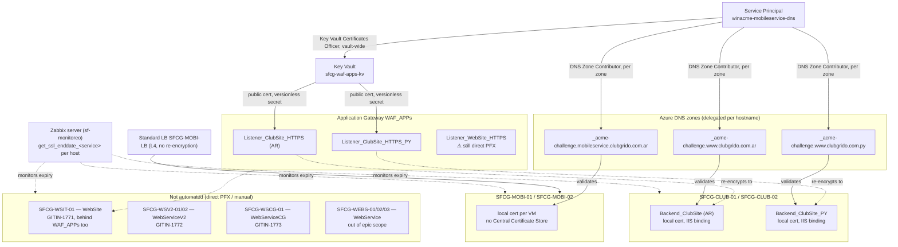

# SmartLoyalty — SSL/TLS Certificate Reference

**Last updated:** 2026-09-09
**Subscription:** Smart IT - Grido (`0190fa7d-4ccf-4e3d-beb1-323b5780bfc8`)

Certificate inventory, automation status, and architecture for every public-facing SmartLoyalty/Grido service. Split out of `infrastructure.md` since this topic has its own shared architecture (DNS delegation, a common Service Principal, a shared Key Vault) that cuts across multiple otherwise-unrelated hosts. The actual investigation/implementation work lives in `operations/` (this is a cross-cutting concern owned by the SSL-automation epic, not a loyalty-specific ticket stream) — this doc is the loyalty-side reference for which hostnames are covered, not covered, and how the pieces fit together.

Epic: [GITIN-1768](https://smartit-ar.atlassian.net/browse/GITIN-1768) ("Automatizar SSL Loyalty"), motivated by the MobileAppService expiry incident (`GITIN-1758`, August 2026).

---

## Shared automation architecture

Where automation exists, it follows the same pattern everywhere, established in `GITIN-1774` (MobileAppService) and reused since:

- **Validation:** DNS-01 via a dedicated Azure DNS zone per hostname (`_acme-challenge.<hostname>`), NS-delegated from the zone's real DNS provider. HTTP-01 has been ruled out for every `WAF_APPs`-fronted host checked so far — their HTTP listeners are pure HTTPS redirects with no real backend to serve a challenge file.
- **Service Principal:** `winacme-mobileservice-dns` (appId `3cca7e2a-5b4a-4b0d-87ee-4390af90346f`, tenant `33ee786b-c072-4326-8759-7be9b82e9801`) — one shared identity across every host and every zone. **Not** re-scoped automatically: each new `_acme-challenge.*` zone needs its own explicit `DNS Zone Contributor` role assignment.
- **Client:** win-acme (`wacs.exe`), pluggable build. **No Central Certificate Store** — each VM issues and renews its own certificate independently; private keys are non-exportable by default, so nothing is ever copied between VMs, even twin nodes behind the same pool.
- **Public-cert delivery, where fronted by `WAF_APPs`:** Azure Key Vault (`sfcg-waf-apps-kv`, RBAC-mode), referenced by the gateway listener via a **versionless** secret URI — so the gateway picks up renewals automatically, no listener reconfiguration per cycle. The gateway's managed identity (`waf-apps-kv-identity`) has `Key Vault Secrets User` on the vault; the win-acme Service Principal separately needs `Key Vault Certificates Officer` to write to it (granted once, vault-wide — not per hostname).
- **Backend-leg cert, where the gateway re-encrypts:** `WAF_APPs` does end-to-end re-encryption to some backends (confirmed for ClubSite AR/PY) — that means **two independent TLS legs per hostname**: Client↔Gateway (above) and Gateway↔Backend (a separate, locally-issued cert on the backend VM itself, delivered to the Windows Certificate Store + an IIS binding, never to Key Vault). Automating only the public leg and leaving this one manual/expired is a full-outage risk unrelated to the public cert's validity — this is exactly what happened for both ClubSite AR (discovered mid-`GITIN-1770`, GoDaddy cert, ~3 months' runway) and ClubSite PY (discovered mid-`GITIN-1769`, already Let's Encrypt from an unidentified prior source, 6 days' runway). **Always check `backendHttpSettingsCollection[].protocol` for `Https` before declaring a `WAF_APPs`-fronted hostname's cert automation complete.**
- **`trustedRootCertificates` on the gateway:** only accepts a genuinely self-signed root (`Issuer == Subject`) — Let's Encrypt's intermediates (`YR1`/`YR2`/`YE2`, rotating) are rejected and must never be uploaded there; the backend's own IIS binding serves the intermediate as part of the TLS handshake. A `null`/unset value isn't automatically a gap: Application Gateway v2 trusts well-known public CAs by default, so a backend cert that already chains to one (e.g. `ISRG Root X1`) can pass health checks with no explicit trust object at all — confirmed for ClubSite PY.

---

## Status by service

| Service | Public hostname | Ingress | Public-leg cert | Backend-leg cert | Status | Ticket |
|---|---|---|---|---|---|---|
| MobileAppService | `mobileservice.clubgrido.com.ar:8043` | `SFCG-MOBI-LB` (Standard LB, L4 only) | Windows Cert Store, per VM | N/A — LB doesn't re-encrypt | **Automated, verified** | `GITIN-1774` |
| ClubSite AR | `www.clubgrido.com.ar` | `WAF_APPs` | Key Vault (`sfcg-waf-apps-kv`) | Windows Cert Store, per VM (`SFCG-CLUB-01`/`02`) | **Automated, verified** | `GITIN-1770` |
| ClubSite PY | `www.clubgrido.com.py` | `WAF_APPs` | Key Vault (`sfcg-waf-apps-kv`) | Windows Cert Store, per VM (`SFCG-CLUB-01`/`02`) | **Automated, verified** | `GITIN-1769` |
| WebSite | `gestion.clubgrido.com.ar` | `WAF_APPs`, single backend (`SFCG-WSIT-01`), no redundancy | Direct PFX, not migrated | Unconfirmed — check `backendHttpSettingsCollection` for re-encryption before assuming scope matches ClubSite | Not started | `GITIN-1771` |
| WebServiceV2 | — (not yet documented here) | No `WAF_APPs`/L7 device in front (per `infrastructure.md`) | Direct/manual, not migrated | N/A — no gateway to re-encrypt | Not started | `GITIN-1772` |
| WebServiceCG | — (not yet documented here) | No `WAF_APPs`/L7 device in front | Direct/manual, not migrated | N/A | Not started | `GITIN-1773` |
| WebService (on-premise SmartFran, `SFCG-WEBS-01/02/03`) | — | No `WAF_APPs`/L7 device in front | Direct/manual, not migrated | N/A | **Out of epic scope** — not one of `GITIN-1768`'s 6 subtasks | — |

`fs-api` appears as a monitored service name in Zabbix's SSL-expiry checks (see below) but has no corresponding entry in `infrastructure.md`'s host table — not yet mapped to a real hostname/VM in this repo. Don't assume it maps to any host above without checking.

---

## Architecture map

---

## Per-service notes

### MobileAppService
Fully automated and verified on both VMs (`GITIN-1774`). No backend-leg complication — `SFCG-MOBI-LB` is a plain L4 load balancer, no re-encryption. Full procedure (manual stopgap + the automated replacement): `operations/docs/mobileappservice_ssl_renewal_runbook.md`.

### ClubSite AR / ClubSite PY
Both legs automated and verified on both `WAF_APPs`-fronted hostnames sharing `SFCG-CLUB-01`/`SFCG-CLUB-02`. Shared runbook (written for AR, reused verbatim for PY): `operations/docs/waf_apps_cert_automation_runbook.md`. Full investigation detail: `operations/events/20260806_automatizar_clubsite_ar/`, `operations/events/20260806_automatizar_clubsite_py/`.

Both hostnames currently have an orphaned direct-PFX certificate object left on the gateway after their listener migrated to the Key Vault-backed object (`clubgrido.2023.2024` for AR, `www.clubgrido.com.py_2026_v2` for PY) — cleanup vs. keep-as-backup is an open decision on both, not yet made.

### WebSite, WebServiceV2, WebServiceCG
Not started. `GITIN-1771` (WebSite) is the next candidate — it's also behind `WAF_APPs`, so the same pattern (and the same "check for backend re-encryption before declaring done" caution) should apply, but this hasn't been verified yet: unconfirmed whether `gestion.clubgrido.com.ar`'s DNS access matches `clubgrido.com.ar`'s (should, same domain) or whether its HTTP listener has the same backend-less-redirect issue. `GITIN-1772`/`GITIN-1773` (WebServiceV2/WebServiceCG) sit behind no `WAF_APPs`/L7 device per `infrastructure.md` — their automation design (if any) hasn't been scoped yet and may not follow the Key Vault pattern at all, since there's no gateway to reference a Key Vault secret from.

### WebService (on-premise SmartFran)
`SFCG-WEBS-01/02/03` is **not** one of `GITIN-1768`'s six subtasks — its certificate situation hasn't been investigated under this epic at all. Zabbix's `smartfran`-named SSL-expiry check (see below) may or may not correspond to this service; not confirmed.

---

## Zabbix SSL-expiry monitoring

Certificate *expiration* is monitored independently of whether renewal is *automated* — this exists for every service regardless of its row in the status table above, including the ones with no automation yet (that's precisely where it matters most).

Not monitored per-VM. Runs centrally on the **`Zabbix server`** host itself (`sf-monitoreo.smartfran.com`): one `log[]`-type active-check item per service, named `get_ssl_enddate_<service>` (e.g. `get_ssl_enddate_webservicecg`), each reading its own log file under `/var/log/zabbix/ssl_<name>.log` on the Zabbix server, each with its own independent set of 4 triggers. Tagged `cloud:Azure` / `component:SSL Cert` / `env:PROD`. Confirmed present for `webservicecg`, `webservicev2`, `website`, `smartfran`, `mobileappservice`, `fs-api`, `clubsite_ar`, `clubsite_py` (`GITIN-1961`, 2026-08-28).

When auditing a VM's Zabbix onboarding for cert-expiry coverage, check the `Zabbix server` host, not the VM itself — its absence there is expected, not a gap. Full Zabbix architecture (host onboarding checklist, alert routing, known bugs): `../../docs/zabbix_observability.md`.

---

## Related

- `operations/docs/mobileappservice_ssl_renewal_runbook.md` — MobileAppService, full procedure.
- `operations/docs/waf_apps_cert_automation_runbook.md` — `WAF_APPs`-fronted hosts (ClubSite AR/PY today, designed for WebSite too), full procedure including the backend-leg trust-chain steps.
- `operations/events/20260805_waf_services_cert_automation_feasibility/` — shared technical context for the `WAF_APPs` hosts (topology, Key Vault decision, cert sprawl).
- `operations/events/20260807_automatizar_ssl_loyalty_epic/` — epic-level status/Mermaid tracker for `GITIN-1768`'s six subtasks (ticket-status view; this doc is the architecture/reference view — they answer different questions).
- `infrastructure.md` — host/network reference this doc was split out of.
- `../../docs/zabbix_observability.md` — cross-project Zabbix reference.
