# TaskOperatorService — Task Inventory Reference

**Last updated:** 2026-09-24 (§5 `idx_cpl` duration placeholder replaced with the first two real live-run values, GITIN-2061); 2026-09-22 (§3 `Sch.Job` candidate link to `Etl CustomerPointsLog`; §5 diagrams refreshed to the applied "third iteration" schedule)
**Host:** `SFCG-TO-01`
**Source investigation:** `events/20260901_pnssrl_mantenimientoindices_review/` (GITIN-1981)

`SmartLoyalty.TaskOperator.Service` (the real service name — see `GITIN-1828`/`events/20260812_taskoperator_alert_not_running/`, a prior mismatch against `Solution.SmartLoyalty.TaskOperatorService` silently broke its own health check) hosts **three distinct, unrelated scheduling/execution mechanisms**. This doc exists because that distinction wasn't obvious until GITIN-1981 needed to check all of them for `Sml.CustomerPointsLog` contention — don't conflate them.

| # | Mechanism | What it is |
|---|---|---|
| 1 | Windows Task Scheduler, `\SmartFran\` folder | ~54 independently-scheduled `.ps1` scripts, each calling a numbered `QueryNNN-sql.xml` (or a few with no DB query at all) |
| 2 | `Etl` framework — `Etl.EtlOperationConfig`/`Etl.EtlOperationExecution` (inside `SmartFran.Solution.SmartLoyalty`) | Config-driven data-sync operations, executed by TaskOperatorService |
| 3 | `Sch` schema — `Sch.Task`/`Sch.Job`/`Sch.TaskEvent` (inside `SmartFran.Solution.SmartLoyalty`) | TaskOperatorService's own internal job/task/step engine for ad-hoc, campaign-triggered business actions |

---

## 1. Windows Task Scheduler — `\SmartFran\` folder

Scripts live at `Front/SmlBackScript/` in the source repo (`loyalty/repo/dev-src-sol-smartloyalty/`); a deployed mirror (credentials stripped) is at `loyalty/repo/SmartLoyalty.SmlBackScript/` — useful for confirming no drift between source and what's actually running (checked for `PointsLogGenerator`, 2026-09-10: identical).

**Schedule times below are as returned by `Get-ScheduledTaskInfo` on `SFCG-TO-01`** — treated as UTC directly, consistent with established precedent in this repo (`infrastructure.md` matches `Check_list_SF`'s cadence against GMT incident times with no conversion). Not independently re-verified against the server's OS timezone setting.

**"Touches `Sml.CustomerPointsLog`" was verified against actual query content** (`Front/SmlBackScript/Query/QueryNNN-sql.xml`), not by task/script name — name-matching proved unreliable during this audit (`PointsLogGenerator` looked unrelated by an earlier, buggy check; it isn't). Two known method traps to avoid repeating: (a) a *second*, unrelated `Query/` folder exists at `Core/Domain.Query/Domain/Query/` with overlapping numeric filenames — always resolve against `Front/SmlBackScript/Query/`, the one these scripts actually load; (b) match bracketed schema notation too (`[Sml].[CustomerPointsLog]`), not just unbracketed.

**Purpose descriptions below are the query authors' own** (extracted from each `QueryNNN-sql.xml`'s `<Description>` field, translated to English here) — not inferred from task/script names, for the same reliability reason as the `CustomerPointsLog` check above. Where no query exists or no description was recorded, marked accordingly rather than guessed.

| Task | Script | Query | Purpose (author's own description) | Touches `Sml.CustomerPointsLog`? | Schedule (UTC) | Duration |
|---|---|---|---|---|---|---|
| Alerts Update | AlertGenerator.ps1 | Query008 | Alerts (no further detail recorded) | **TOUCHES** | 07:00 daily | 44-76s |
| AssignPointFirstSaleApp | AssignPointFirstSaleApp.ps1 | Query046 | Assigns points to a customer for their first purchase via an exclusive app promotion | **TOUCHES** | 04:00 daily | <1s |
| AssignPointNewCustomers_New | AssignPointNewCustomers.ps1 | Query080 | Assigns points to customers who registered yesterday | **TOUCHES** | dormant (no `NextRunTime`, last ran 2025-04-09) | — |
| Calculate Weight Grams Per BranchOffice | WeightGramsPerBranchOffice.ps1 | Query032 | No description recorded — name implies grams-sold calc per branch | clear | 10:00 daily | — |
| Cancel Customer Account | CancelCustomerAccount.ps1 | Query006 | Processes account cancellation requests, once daily | clear | 08:30 daily | — |
| Check_list_SF | ServicesAndTaskStatus.ps1 | — (no DB query) | Checks whether `TaskOperatorService` is running (confirmed, GITIN-1828) | n/a | every 5min | — |
| Clean Mistery | FreeMistery.ps1 | Query007 | Releases pending "mystery" gift purchases | clear | every 30min | — |
| ClickExportsBranchOffice | ClickExportsBranchOffice.ps1 | Query078 | Weekly report exporting favorite branch offices per franchise | clear (`SmlSt` staging schema) | 11:15 weekly | — |
| ClubGrido Consignment AR | ClubGridoConsignmentAR.ps1 | Query015 | Factory consignment settlements | clear | 11:00 weekly | — |
| ClubGrido Consignment PY | ClubGridoConsignmentPY.ps1 | Query015 | Factory consignment settlements (same query as AR) | clear | 12:00 weekly | — |
| CountPushNotificationsMonthly | PushNotifications.MonthlyReport.ps1 | Query035 | Monthly report of push notifications activated per franchise | clear | 11:30 monthly | — |
| Customer Mailing Generator | CustomerMailingGenerator.ps1 | Query012 | Generates the mailing table | clear | 07:30 daily | — |
| CustomerAndCardAmount | CustomerAndCardAmount.ps1 | Query025 | Counts customers/cards with and without purchase data, per franchise | clear | 08:05 daily | — |
| CustomerFavoriteBranchOffice | CustomerFavoriteBranchOffice.ps1 | Query034 | Sets each customer's favorite franchise based on their consumption | clear | 10:10 daily | — |
| CustomerPointLog_to_BlobStorage | CustomerPointsLogToBlob.ps1 | QueryCustomerPointsLog | Extracts the member points table [to blob storage] | clear (reads `SmlSt.CustomerPointsLog`, the staging copy `PointsLogGenerator` maintains — see §2 note below) | multiple runs/day | — |
| Customers Evolution Update | CustomerEvolutionGenerator.ps1 | Query009 | Processes customers and pending customers | clear | 08:00 daily | — |
| DailyServerStorage | DailyServerStorage.ps1 | — | No description recorded — name implies disk-storage reporting | n/a | 01:01 daily | — |
| Deactivate Recovery Codes | DeactivateRecoveryCodes.ps1 | Query013 | Invalidates codes older than 10 days and deactivates expired account recoveries | clear | 08:30 daily | — |
| DeactivateAccountRecovery90Days | DeactivateAccountRecovery90Days.ps1 | — | No description recorded — name implies 90-day account-recovery deactivation | n/a | 09:00, irregular cadence | — |
| DeactivateSuscriptionByVigencyPromotion | DeactivateSuscriptionByVigencyPromotion.ps1 | — | No description recorded — name implies subscription deactivation tied to promotion validity | n/a | 07:15 daily | — |
| Delete Today Sale Customer | DeleteTodaySaleCustomer.ps1 | Query019 | Clears the `TodaySaleCustomer` table | clear | 03:01 daily | — |
| DeleteCustomerPendingData | DeleteCustomerPendingData.ps1 | Query022 | Deletes old pending-customer data, or data for customers who already completed registration | clear | 06:45 daily | — |
| ExchangeReportsMonth | ExchangeReportsMonth.ps1 | Query041+042 | Frequent-consumption alert report; monthly redemptions report | **TOUCHES** | 08:00 monthly | — |
| FranchisesWithManualCardTyping | FranchisesWithManualCardTyping.ps1 | — | No description recorded — name implies franchises using manual card entry | n/a | 11:00 monthly | — |
| Generate Location | LocationGenerator.ps1 | Query010 | Generates the `Location` table | clear | 10:32 daily | — |
| NotSamplesSurveyActivated | NotSamplesSurveyActivated.ps1 | Query054 | Identifies active/valid surveys that returned no sample data | clear | 12:05 daily | — |
| Orphans Notify | OrphansNotify.ps1 | Query001+002 | Looks up and updates "orphan" records | clear | 09:30 daily | — |
| PointsFranchisePY | PointsFranchisePY.ps1 | Query073 | Total accumulated points per franchise | **TOUCHES** | 10:45 weekly | — |
| PointsLogGenerator | PointsLogGenerator.ps1 | Query074 | Rebuilds the temporary `CustomerPointsLog` staging table (`SmlSt.CustomerPointsLog`, from `Sml.CustomerPointsLog`) | **TOUCHES** — `DROP`/`CREATE`/`INSERT...SELECT...GROUP BY` on the production table | 07:30 daily | — |
| Program Results | ProgramResults.ps1 | Query031 | No meaningful description recorded (`.` only) — purpose not independently confirmed | **TOUCHES** | 11:00 daily | 30-33s |
| Promotion Vigency Advisor A | PromotionVigencyAdvisorA.ps1 | Query004 | Emails SmartFran's special users about promotions expiring within the next 10 days | clear | 11:40 daily | — |
| Promotion Vigency Advisor B | PromotionVigencyAdvisorB.ps1 | Query005 | Emails SmartFran's special users about promotions taking effect but not yet activated, and recently created ones | clear | 12:20 weekly | — |
| Promotion Vigency Advisor C | PromotionVigencyAdvisorC.ps1 | Query011 | Same description as Advisor B (query text differs, description was copy-pasted at authoring time) | clear | 12:30 weekly | — |
| RegistrationMembersPY | RegistrationMembersPY.ps1 | Query072 | Member sign-up processing | clear | 10:45 weekly | — |
| Report Franchise ClubGrido | ReportFranchiseClubGrido.ps1 | Query058 | Report of franchises with ClubGrido | clear | 09:00 monthly | — |
| ReportCampaingAutoG | ReportCA.ps1 | — | No description recorded — name implies an automated campaign report | n/a | 10:30 monthly | — |
| ReportCampaingAutoGWeek | ReportCAWeekly.ps1 | — | No description recorded — weekly variant of the above | n/a | 11:00 weekly | — |
| ReportErrorSurveyNoResponse | ReportErrorSurveyNoResponse.ps1 | — | No description recorded — name implies a no-response survey error report | n/a | 12:00 daily | — |
| ReportFrequentlyConsumption | ReportFrequentlyConsumption.ps1 | Query003 | Frequent-consumption alerts sent to franchisees | clear | 11:00 weekly | — |
| ReportManualPointsAssignmentIndividual | ReportManualPointsAssignmentIndividual.ps1 | Query070 | Points traceability report | **TOUCHES** | 11:00 weekly | — |
| ReportManualPointsAssignmentLists | ReportManualPointsAssignmentLists.ps1 | Query069 | Points traceability report, for bulk lists | **TOUCHES** | 11:00 weekly | — |
| ReportPointsTransfer | ReportPointsTransfer.ps1 | Query064 | Monthly points-transfer report | **TOUCHES** | 11:30 monthly | — |
| ReportSampleMailResponseXSurvey | ReportSampleMailResponseXSurvey.ps1 | Query060+061 | Extraction of surveys sent (SML) and surveys received (DW) | clear | 06:00 daily | — |
| ReportsAssociation | ReportsAssociation.ps1 | Query071 | Report of complete and pending member sign-ups (Paraguay) | clear | 11:00 monthly | — |
| ReportSurveyUnsatisfied | ReportSurveyUnsatisfied.ps1 | Query049 | Unsatisfied-survey responses report | clear | 10:00 daily | — |
| ReportUpdateCustomer | ReportUpdateCustomer.ps1 | Query062+063 | Mass member-update report | **TOUCHES** | 12:00 monthly | — |
| RunExportsCustomersFails | RunExportsCustomersFails.ps1 | Query036 | Re-runs member-export campaigns that previously failed | clear | ~13:00 | — |
| RunProccessETLFails | RunProccessETLFails.ps1 | Query0000 | No description recorded — name implies retrying failed ETL processes | clear | ~14:00 | — |
| SaleGrams | SaleGrams.ps1 | Query023 | Grams sold via promo vs. regular sale | clear | 08:30 daily | — |
| SaleMix | SaleMix.ps1 | Query024 | Sales mix per franchise | clear | 08:45 daily | — |
| SendArticlesToBlobStorage | SendArticlesToBlobStorage.ps1 | Query075 | Exports Articles data to PowerBI and Concentrador | clear | 10:00 daily | — |
| SendCanjesSocioCortesiaToBlobStorage | SendCanjesSocioCortesiaToBlobStorage.ps1 | Query076 | Exports member courtesy-point redemptions — **flagged by its own author as "(Robo de Puntos)"**, i.e. "Points Theft" | **TOUCHES** | every 30min, **only 11:00-03:00 UTC — confirmed dormant 03:00-11:00, not 24/7** | 11-20s |
| SendDetalleCanjesSocioCortesiaToBlobStorage | SendDetalleCanjesSocioCortesiaToBlobStorage.ps1 | Query077 | Detail records for Query076's export — same author's "(Robo de Puntos)"/"Points Theft" flag | **TOUCHES** | every 30min, same 11:00-03:00 window | 6-17s |
| SendMailDailyReportDisk | SendMailDailyReportDisk.ps1 | — | No description recorded — name implies a daily disk-usage report email | n/a | 23:30 daily | — |
| TaskOperatorDailyReports | ReportWarningsTaskOperator.ps1 | Query052 | TaskOperator warnings report | clear | 11:00 daily | — |

**Notable:** `Query076`/`Query077` (`SendCanjesSocioCortesiaToBlobStorage`/`SendDetalleCanjesSocioCortesiaToBlobStorage`) are the *only* two entries in this table whose own author-written description names a fraud concern directly — "Robo de Puntos" ("Points Theft") — for exactly the courtesy-point redemption pattern these export. Worth cross-referencing against `loyalty/memory/` (fraud actor memory) and the `fraud-points`/`fraud-pos` skills if that pattern hasn't already been connected to known fraud investigations in this repo — not chased further here, out of scope for GITIN-1981.

**Reading the "TOUCHES" column for risk:** touching `Sml.CustomerPointsLog` only matters if something else holds a conflicting lock on that table at the same time (e.g. `PNSSRL_MantenimientoIndices`'s offline index rebuild, `Sch-M` for its full duration). On its own, every touching task here runs briefly (confirmed durations above, where known: under 80 seconds each) — a lock conflict delays the task until the lock releases, it doesn't create sustained contention. See GITIN-1981 for the full scheduling analysis this table was built for.

---

## 2. `Etl` framework

`Etl.EtlOperationConfig` (definitions) / `Etl.EtlOperationExecution` (real execution history/limits), inside `SmartFran.Solution.SmartLoyalty`. Executed by TaskOperatorService (`SFCG-TO-01`, login `sfsqlusr`).

**Schema correction (2026-09-22, `events/20260922_gitin2060-mantenimientoindices-reschedule/`):** the staged-but-never-run queries in `events/20260901_pnssrl_mantenimientoindices_review/scripts.sql` (Q29a/Q29b) assumed column names (`OperationName`, `FromTable`, `Enabled`, `StartDate`/`EndDate`, `OperationConfigId`) that don't exist — caught only when actually running them. Real schema: `Etl.EtlOperationConfig` has `Id, ToTable, FromQuery, Mappings, BatchSize, SetSize, InputConnStr, OutputConnStr, DeleteFirst, FullTable, IdLimits, MaxExecutionPeriod, UpdateColumns, UpdateWhereColumns` — **no name field and no schedule/trigger-time column at all**; trigger timing can only be inferred from real execution history, not read from config. `Etl.EtlOperationExecution` has `Id, TotalRows, Started, LowerLimit, UpperLimit, Completed, EtlOperation_Id`.

**Full operation list, now pulled (30-day execution history, 2026-09-22):** 9 operations confirmed active, all running **daily** (no day-of-week gating observed on any of them):

| ConfigId | ToTable | Typical start (UTC) | Typical duration |
|---|---|---|---|
| 1 | `dbo.Sale` | ~08:55 | minutes (200-800s typical, up to ~4500s seen) |
| 2 | `dbo.Location` | ~07:10 | ~20-27s |
| 3 | `dbo.Exchange` | ~08:40 | ~50-70s (occasional multi-thousand-second outliers) |
| 4 | `dbo.SaleCustomer` | ~08:25 | ~300-700s |
| 5 | `dbo.Customer` | ~07:55 | ~50-160s (occasional multi-thousand-second outliers, e.g. Mondays) |
| 6 | `dbo.CustomerPointsLog` | ~07:25 (05:00 from 2026-09-24, see below) | **3-6+ hours, chronically slow — see below** |
| 7 | `dbo.BranchOffice` | ~08:10 | ~13-26s |
| 11 | `Sml.Target` | ~08:00 | near-instant (<5s) |
| 15 | `dbo.PointsTransference` | ~13:00 | near-instant (<10s) |

**`CustomerPointsLog` (`Id=6`) detail:** habitual trigger ~07:25 UTC through 2026-09-23, moved to 05:00 UTC effective 2026-09-24 (`Sch.TimeTable.Id=755`, part of GITIN-2060's third-iteration schedule — see §3). Chronic slow throughput — root cause a non-sargable `OR` predicate plus a `COUNT(*) OVER()` pre-query in its `FromQuery` (full detail in `events/20260715_cpu_spikes/`, proposed fix not yet applied). 30-day history confirms: runs all 7 days, typical duration 3-6 hours, one extreme outlier of 25.9 hours (started Wed 2026-09-09, completed Thu 2026-09-10 — likely why no separate Thursday trigger fired that day, not confirmed). Average duration by weekday (excluding that outlier): Monday worst (~5.4h), then Tuesday (~4.6h), Sunday (~3.9h), Saturday (~3.3h), Friday (~3.2h), Thursday (~3.0h), Wednesday best (~2.65h). **Genuinely overlaps `Backup_FULL`'s 06:00 UTC start every day it runs** (since it runs daily regardless of day-of-week) — confirmed during GITIN-2060's post-close schedule-overlap check, pre-existing, not something any single reschedule can eliminate without fixing this operation's own duration. Candidate for its own future ticket.

Relationship to §1: this is a **different** `dbo.CustomerPointsLog` sync target than `PointsLogGenerator`'s `SmlSt.CustomerPointsLog` staging table — two independent sync mechanisms exist for `CustomerPointsLog`-derived data, both reading the same production table, neither aware of the other as far as this investigation found.

---

## 3. `Sch` schema — internal campaign-action engine

`Sch.Task` / `Sch.Job` / `Sch.TaskEvent`, inside `SmartFran.Solution.SmartLoyalty`. Discovered during GITIN-1981 while chasing task-duration data for §1 — **this schema does not track `\SmartFran\` Windows Task Scheduler tasks at all**; it's a separate, internal job/task/step engine TaskOperatorService uses for ad-hoc business actions, confirmed via `Sch.TaskEvent.Operator` values all reading `SmartFran.Solution.SmartLoyalty.Front.TaskOperatorService.exe`.

**Confirmed example:** `MktAsignationPointActionManager` — job names formatted `MktAsignationPointActionManager - ActionId: <N> - MktCampaignId: <N>`, i.e. marketing-campaign-triggered point assignment actions.

**Correction (GITIN-2036, 2026-09-14):** the "not on any fixed daily schedule" phrasing above is misleading for blocking-risk purposes and should not be read as "these jobs have quiet hours." Confirmed via `Sch.Task` history and cross-checked against every `MktAsignationPointActionManager` campaign job since 2021: these jobs run continuously on a fixed **~5-minute cadence, 24/7, with zero quiet hours observed in practice**, for the campaign's entire `ValidSince`-`ValidTo` lifetime — this is universal behavior of the job type, not specific to any one campaign. `Sch.Job` itself has no recurrence-interval/active-hours/blackout column (only `Id, Name, Description, ValidSince, ValidTo, DeactivatedDate, DeactivateNote`).

**Second correction (GITIN-2036, same session, later, now fully confirmed):** the line originally here — "there is no way to reschedule or pause these jobs at the DB config level" — was **wrong**, not just too strong. `Sch.Task.TimeTableId` (1:1 with `JobId`) points to `Sch.TimeTable`, a real schedule-config table (columns: `Enabled, ActiveStartDate, ActiveEndDate, FrecuencyType, FrecuencyInterval, FrequencyRecurrenceFactor, FrecuencySubDayInterval`, resembling SQL Agent's own `sysschedules`). After a `SELECT` grant was applied, the actual row for campaign 537's `TimeTableId` confirmed `FrecuencyType='Minutes'`, `FrecuencyInterval=5` — **the 5-minute cadence is a plain, directly configurable integer value**, not hardcoded application logic. `ActiveStartDate`/`ActiveEndDate` just mirror the parent job's own `ValidSince`/`ValidTo` — there is genuinely **no time-of-day or day-of-week blackout field** in this schema, so "these jobs have no quiet hours" (the first correction above) still holds. But "the interval can't be changed" does not — it demonstrably can, via a single-row `Sch.TimeTable` update. Changing it is a business/campaign-cadence decision (affects how fast point assignment runs for real customers), not purely a DBA one — flag that distinction to whoever considers using this lever.

See `events/20260914_taskoperator_mktcampaign537_errors/investigation.md` (Q21-Q23, Q29-Q30) for the full detail, including the confirmed row values.

**Sch.Task columns:** `Id, ExecuteOn, ExecutionStarted, Done, DeactivatedDate, DeactivateNote, TimeTableId, Failed, JobId, CanceledDate, CanceledNote`

**Sch.TimeTable columns (full set, confirmed 2026-09-22):** `Id, JobId, Enabled, ActiveStartDate, ActiveEndDate, Name, FrecuencyType, FrecuencyInterval, FrequencyRecurrenceFactor, FrecuencySubDayInterval` — the last one (`time` type) wasn't exercised by the campaign-537 precedent and is the key field for daily time-of-day schedules (see below).

**Sch.TaskEvent columns:** `Id, JobId, TaskId, StepId, Job_Name, Job_ValidSince, Job_ValidTo, Job_DeactivatedDate, Job_DeactivateNote, Task_ExecuteOn, Task_ExecutionStarted, Task_Done, Task_DeactivatedDate, Task_DeactivatedNote, Task_CanceledDate, Task_CanceledNote, Task_Failed, Step_Command, Step_Params, EventData, EventCode, EventDate, Operator`

**Not yet explored:** what other job types besides `MktAsignationPointActionManager` run through this engine, or whether any of them touch `Sml.CustomerPointsLog` — out of scope for GITIN-1981 (campaign-triggered, not schedulable to a fixed time), flagged here for whoever needs it next.

**Confirmed link to §2's `Etl CustomerPointsLog` (2026-09-22, `events/20260922_gitin2060-mantenimientoindices-reschedule/`):** `EtlOperationConfig` itself has no schedule column (§2), so the trigger mechanism was traced through `Sch.Job`. `Sch.Job.Id=755`, `Name=EtlDwGridoCustomerPointsLogProcessor`, is the confirmed trigger for `Etl.EtlOperationConfig.Id=6` (`dbo.CustomerPointsLog`) — its `Sch.TimeTable` row (`Id=755`, `FrecuencyType='Daily'`, `FrecuencyInterval=1`, **`FrecuencySubDayInterval=07:25:00`**) matches the operation's known trigger time exactly, and its `Sch.Task` execution history (20 rows, 2026-09-04 through 2026-09-23) fires at 07:25 UTC every day with `Done` timestamps 2h48m-5h+ later, matching the already-documented 3-6h duration pattern.

**The daily time-of-day field is `Sch.TimeTable.FrecuencySubDayInterval`** (a `time` column) — not `ActiveStartDate`'s time component (`00:00:00` here, irrelevant for `Daily`/interval-1 schedules). A permanent change is a single-row update: `UPDATE Sch.TimeTable SET FrecuencySubDayInterval = '<new time>' WHERE Id = 755`. `dbo.RescheduleTask` (a stored proc initially considered) is **not** the right tool — it only updates one `Sch.Task.ExecuteOn` occurrence, never `Sch.TimeTable`, so it can't produce a permanent recurring change.

Full detail: `events/20260922_gitin2060-mantenimientoindices-reschedule/investigation.md`.

---

## 4. Hourly load summary (00-23 UTC)

Built from §1's Schedule column, for the GITIN-1981 scheduling analysis. "Other tasks" = the daily/weekly/monthly `\SmartFran\` tasks confirmed **clear** of `Sml.CustomerPointsLog`, bucketed by the hour they land in (excludes the two continuous background tasks, `Check_list_SF`/`Clean Mistery`, which run all day). "SmlCPL touches" lists only the tasks confirmed touching the table (§1's **TOUCHES** rows) that fall in that hour, with their known per-run duration.

| Hour (UTC) | PoS active? | SmlCPL touches (duration) | Other tasks (#) |
|---|---|---|---|
| 00 | Yes | — | 0 |
| 01 | Yes | — | 1 (DailyServerStorage) |
| 02 | Yes | — | 0 |
| 03 | Yes | — | 1 (Delete Today Sale Customer) |
| 04 | Yes | AssignPointFirstSaleApp (<1s) | 0 |
| 05 | No (from 05:00) | — | 0 |
| 06 | No | — | 2 |
| 07 | No | Alerts Update (44-76s), PointsLogGenerator (reads table) | 2 |
| 08 | No | ExchangeReportsMonth (monthly) | 6 |
| 09 | No | — | 3 |
| 10 | No | PointsFranchisePY (weekly, 10:45) | 7 |
| 11 | No | Program Results (30-33s), ReportManualPointsAssignmentIndividual/Lists (weekly), SendCanjes/DetalleSocioCortesia (start of 30min cycle, 11-20s / 6-17s) | 9 |
| 12 | No | ReportUpdateCustomer (monthly), SendCanjes/Detalle (continues) | 5 |
| 13 | Yes (from 13:00) | SendCanjes/Detalle (continues) | 1 |
| 14 | Yes | SendCanjes/Detalle (continues) | 1 |
| 15-22 | Yes | SendCanjes/Detalle (continues, every 30min until 03:00) | 0 |
| 23 | Yes | SendCanjes/Detalle (continues) | 1 (SendMailDailyReportDisk) |

Not shown: weekly-only jobs outside this inventory (`Backup_FULL` Sun/Mon/Wed 06:00, `Depura Tempdb` Sun 03:00, `CapturaUsoIndices` Thu/Fri 23:00 — all SQL Agent jobs, not `\SmartFran\` tasks) and the `SFCG-MOBI-01` traffic spike at 07:00-08:00 UTC. Full annotated version, including the `PNSSRL_MantenimientoIndices` rebuild window comparison, in `events/20260901_pnssrl_mantenimientoindices_review/db_schedule_chronogram.txt`.

**Note (2026-09-22):** `Backup_FULL` moved from Sun/Mon/Wed to Mon/Wed/Fri under GITIN-2060 — see §5 below for the current full picture, including SQL Agent jobs and the `Etl` framework this table doesn't cover.

---

## 5. Full daily load — all mechanisms combined (added 2026-09-22, GITIN-2060)

Three complementary Mermaid diagrams. The first is a single representative day showing every mechanism that runs *daily* (§1's daily Windows tasks, all 9 `Etl` operations, `Sch.Job` campaigns, index maintenance, backups) — day-of-week only matters for two items (`Backup_FULL`, index maintenance), which the second diagram shows across a full week. The third covers the ~18 weekly/monthly Windows tasks §1 records time-of-day for but not day-of-week (not yet independently confirmed via `Get-ScheduledTask` trigger data).

### 5.1 Daily detail (any given day, UTC)

```mermaid
gantt
    title SFCG-DB01 / SFCG-TO-01 - carga diaria completa (dia representativo, UTC)
    dateFormat HH:mm
    axisFormat %H:%M

    section Backups semanal
    Backup_FULL dom-mie-vie 2h no confirmada :crit, bak_full, 09:00, 2h
    Backup_Log continuo cada 10min :active, bak_log, 00:00, 24h

    section Mantenimiento de indices
    PNSSRL_MantenimientoIndices lun-mar-jue-sab :active, idx_main, 09:00, 45m
    PNSSRL_MantenimientoIndices_CustomerPointsLog lun-mar-jue-sab primer run 58m47s warm run 3m29s :crit, idx_cpl, 09:15, 59m

    section Sch.Job motor de campanas
    Sch.Job campanas 5min 24-7 sin ventana :active, sch_camp, 00:00, 24h

    section Etl framework 9 operaciones diarias
    Etl Location :crit, etl_loc, 07:10, 27s
    Etl CustomerPointsLog 3 a 6h tipico peor lunes aplicado 2026-09-22 :crit, etl_cpl, 05:00, 4h
    Etl Customer :crit, etl_cust, 07:55, 3m
    Etl Target :crit, etl_tgt, 08:00, 1m
    Etl BranchOffice :crit, etl_bo, 08:10, 20s
    Etl SaleCustomer :crit, etl_sc, 08:25, 6m
    Etl Exchange :crit, etl_exc, 08:40, 1m
    Etl Sale :crit, etl_sale, 08:55, 8m
    Etl PointsTransference :crit, etl_pt, 13:00, 5s

    section WST diarios sin CustomerPointsLog
    DailyServerStorage :wst_dss, 01:01, 10m
    Delete Today Sale Customer :wst_dtsc, 03:01, 10m
    AssignPointFirstSaleApp :wst_apfsa, 04:00, 1m
    ReportSampleMailResponseXSurvey :wst_rsmrs, 06:00, 10m
    DeleteCustomerPendingData :wst_dcpd, 06:45, 10m
    DeactivateSuscriptionByVigencyPromotion :wst_dsvp, 07:15, 10m
    Customer Mailing Generator :wst_cmg, 07:30, 10m
    Customers Evolution Update :wst_ceu, 08:00, 10m
    CustomerAndCardAmount :wst_caca, 08:05, 10m
    Cancel Customer Account :wst_cca, 08:30, 10m
    Deactivate Recovery Codes :wst_drc, 08:30, 10m
    SaleGrams :wst_sg, 08:30, 10m
    SaleMix :wst_sm, 08:45, 10m
    DeactivateAccountRecovery90Days :wst_dar90, 09:00, 10m
    Orphans Notify :wst_on, 09:30, 10m
    ReportSurveyUnsatisfied :wst_rsu, 10:00, 10m
    SendArticlesToBlobStorage :wst_satbs, 10:00, 10m
    Calculate Weight Grams Per BranchOffice :wst_wgpbo, 10:00, 10m
    CustomerFavoriteBranchOffice :wst_cfbo, 10:10, 10m
    Generate Location :wst_gl, 10:32, 10m
    ReportErrorSurveyNoResponse :wst_ersn, 12:00, 10m
    NotSamplesSurveyActivated :wst_nssa, 12:05, 10m
    RunExportsCustomersFails :wst_recf, 13:00, 10m
    RunProccessETLFails :wst_rpef, 14:00, 10m
    SendMailDailyReportDisk :wst_smdrd, 23:30, 10m

    section WST tocan Sml.CustomerPointsLog
    Alerts Update 44 a 76s :crit, wst_au, 07:00, 76s
    PointsLogGenerator :crit, wst_plg, 07:30, 5m
    ExchangeReportsMonth mensual :crit, wst_erm, 08:00, 5m
    Program Results 30 a 33s :crit, wst_pr, 11:00, 33s
    TaskOperatorDailyReports :wst_todr, 11:00, 10m
    SendCanjesSocioCortesiaToBlobStorage cada 30min 11h a 03h :crit, wst_scs, 11:00, 18h
    SendDetalleCanjesSocioCortesiaToBlobStorage cada 30min 11h a 03h :crit, wst_sdcs, 11:00, 18h

    section WST continuos
    Check_list_SF cada 5min :active, wst_cls, 00:00, 24h
    Clean Mistery cada 30min :active, wst_cm, 00:00, 24h
    CustomerPointLog_to_BlobStorage multiples por dia :active, wst_cpltbs, 00:00, 24h
```

Duration placeholders (10m) mark items without a confirmed real duration; only items with actual measured durations (`Alerts Update`, `Program Results`, `SendCanjes`/`Detalle`, `Etl CustomerPointsLog`, and — as of 2026-09-24 — `idx_cpl`) use real data.

**`idx_cpl` real duration confirmed (2026-09-24, GITIN-2061, `events/20260922_gitin2061-ix_customerid-partition-rebuild/`):** first live run (2026-09-22, cold, unpartitioned-before-this-job fragmentation) took 58m47s (`sysjobhistory.run_duration` is `HHMMSS`-packed, not raw seconds — corrected after an initial misread). Since `idx_cpl` starts at 09:15, inside `idx_main`'s own 09:00-09:45 window, the two jobs run concurrently for at least a few minutes on any day by design; the cold run's length meant `idx_cpl` continued solo until ~10:13, about 28 minutes past `idx_main`'s normal 09:45 finish. Second live run (2026-09-24, warm, partition kept defragmented by the first run) took only 3m29s — well inside `idx_main`'s window, no extension. Only 2 data points so far — duration likely settles toward the low end on a regular cadence, but the **first run after any gap in the schedule (e.g. after a skipped Wednesday, or after any pause) should be expected to run long and extend past `idx_main`'s usual finish**. Not yet a confirmed blocking risk (the two jobs no longer share a locked object per GITIN-2061), but worth watching if `idx_main`'s own duration is ever pushed later.

### 5.2 Weekly pattern — the two day-restricted items only (applied schedule, GITIN-2060 third iteration, 2026-09-22)

```mermaid
gantt
    title Patron semanal - solo items que varian por dia (Backup_FULL e indices)
    dateFormat HH:mm
    axisFormat %H:%M

    section Domingo
    Backup_FULL :crit, sun_bak, 09:00, 2h

    section Lunes
    PNSSRL_MantenimientoIndices sin CustomerPointsLog :active, mon_idx, 09:00, 45m
    PNSSRL_MantenimientoIndices_CustomerPointsLog :active, mon_cpl, 09:15, 30m

    section Martes
    PNSSRL_MantenimientoIndices sin CustomerPointsLog :active, tue_idx, 09:00, 45m
    PNSSRL_MantenimientoIndices_CustomerPointsLog primer run real 58m47s :crit, tue_cpl, 09:15, 59m

    section Miercoles
    Backup_FULL :crit, wed_bak, 09:00, 2h

    section Jueves
    PNSSRL_MantenimientoIndices sin CustomerPointsLog :active, thu_idx, 09:00, 45m
    PNSSRL_MantenimientoIndices_CustomerPointsLog run real 3m29s particion ya desfragmentada :active, thu_cpl, 09:15, 4m

    section Viernes
    Backup_FULL :crit, fri_bak, 09:00, 2h

    section Sabado
    PNSSRL_MantenimientoIndices sin CustomerPointsLog :active, sat_idx, 09:00, 45m
    PNSSRL_MantenimientoIndices_CustomerPointsLog :active, sat_cpl, 09:15, 30m
```

Everything else (§5.1's Etl/WST/Sch.Job items) applies uniformly to all 7 days — this diagram exists only because `Backup_FULL` and the index-maintenance jobs are the sole mechanisms whose *day* (not just time) changed under GITIN-2060. **`Etl CustomerPointsLog`'s move to 05:00 UTC is now applied** (2026-09-22, via `Sch.TimeTable.FrecuencySubDayInterval`, `TimeTableId=755` — see §3) — effective the following day's task generation, 2026-09-24 (that day's `Sch.Task` row was already generated at the old 07:25 UTC time before the change).

### 5.3 Weekly/monthly Windows tasks — day-of-week not confirmed

The ~18 `\SmartFran\` tasks §1 records a time-of-day for but not a day-of-week (never independently checked via `Get-ScheduledTask` trigger data). Shown on a single axis since day placement is unknown — do not read horizontal position as "this day," only as "this time, on whichever day it actually runs."

```mermaid
gantt
    title WST semanales-mensuales - dia no confirmado, solo horario
    dateFormat HH:mm
    axisFormat %H:%M

    section Semanales
    ClubGrido Consignment AR :wm_ccar, 11:00, 10m
    RegistrationMembersPY :wm_rmpy, 10:45, 10m
    PointsFranchisePY toca CustomerPointsLog :crit, wm_pfpy, 10:45, 10m
    ClickExportsBranchOffice :wm_cebo, 11:15, 10m
    ClubGrido Consignment PY :wm_ccpy, 12:00, 10m
    ReportCampaingAutoGWeek :wm_rcagw, 11:00, 10m
    ReportFrequentlyConsumption :wm_rfc, 11:00, 10m
    ReportManualPointsAssignmentIndividual toca CustomerPointsLog :crit, wm_rmpai, 11:00, 10m
    ReportManualPointsAssignmentLists toca CustomerPointsLog :crit, wm_rmpal, 11:00, 10m
    Promotion Vigency Advisor B :wm_pvab, 12:20, 10m
    Promotion Vigency Advisor C :wm_pvac, 12:30, 10m

    section Mensuales
    Report Franchise ClubGrido :wm_rfcg, 09:00, 10m
    ReportCampaingAutoG :wm_rcag, 10:30, 10m
    FranchisesWithManualCardTyping :wm_fwmct, 11:00, 10m
    CountPushNotificationsMonthly :wm_cpnm, 11:30, 10m
    ReportPointsTransfer toca CustomerPointsLog :crit, wm_rpt, 11:30, 10m
    ReportsAssociation :wm_ra, 11:00, 10m
    ReportUpdateCustomer toca CustomerPointsLog :crit, wm_ruc, 12:00, 10m
```

---

## Related

- `events/20260901_pnssrl_mantenimientoindices_review/` (GITIN-1981) — source investigation for §1's inventory and the `Sml.CustomerPointsLog` scheduling-conflict analysis this was built for.
- `events/20260715_cpu_spikes/` (GITIN-1749's sibling investigation) — root cause detail for the `Etl` `CustomerPointsLog` operation's chronic slow throughput.
- `events/20260812_taskoperator_alert_not_running/` (GITIN-1828) — origin of the `Sch` schema discovery; also the service-name mismatch (`Solution.SmartLoyalty.TaskOperatorService` vs. real `SmartLoyalty.TaskOperator.Service`) that broke `Check_list_SF`'s health check.
- `infrastructure.md` → "Scheduled Tasks (`SFCG-TO-01`)" — older, partial version of §1's inventory; this doc supersedes it as the exhaustive reference.
- `events/20260922_gitin2060-mantenimientoindices-reschedule/` (GITIN-2060) — source of §2's full `Etl` operation list and schema correction; also where the `Backup_FULL`/`CustomerPointsLog` ETL overlap finding is documented in full.
