# GITIN-2060 — Reprogramación de PNSSRL_MantenimientoIndices

**Tags:** SmartLoyalty, PNSSRL, Mantenimiento, PROD, SRE

## Resumen

El job de SQL Agent `PNSSRL_MantenimientoIndices` (rebuild offline diario de índices sobre `SmartFran.Solution.SmartLoyalty`, incluyendo `Sml.CustomerPointsLog`) corría desde hacía tiempo a las 06:15 UTC, horario que provocó bloqueo confirmado contra MobileAppService y el sitio del club en tres oportunidades (GITIN-1866, 2026-08-28/29/30; recurrencia 2026-09-14; recurrencia 2026-09-21, GITIN-2076). La recomendación de mover el horario a 08:00 UTC (05:00 UTC-3) fue investigada y derivada en detalle bajo GITIN-1981, pero nunca se llegó a aplicar bajo ese ticket. Este ticket (GITIN-2060) aplicó ese cambio ya decidido, y el mismo día se extendió en tres iteraciones de diseño adicionales: en vez de solo programar el job cerca de `Backup_FULL` (asumiendo, sin confirmar, que ese backup termina a tiempo), se eliminó por completo el solapamiento entre ambos — el job de mantenimiento de índices (y su compañero de GITIN-2061) ahora no corre en absoluto los días que corre `Backup_FULL`. La tercera iteración fue más allá: un análisis de percentiles reales identificó que la sincronización ETL de `dbo.CustomerPointsLog` (`Etl.EtlOperationConfig.Id=6`, corría diariamente ~07:25 UTC) también contribuía a la contención, especialmente los lunes. Se localizó su mecanismo real de disparo (`Sch.Job`/`Sch.TimeTable`, no Windows Task Scheduler como se asumía) y se reprogramó a 05:00 UTC, junto con un ajuste final de `Backup_FULL`/mantenimiento de índices a domingo-miércoles-viernes / lunes-martes-jueves-sábado, 09:00/09:15 UTC — liberando además la ventana de deploys de las 08:00 UTC-3.

## Tabla resumen

| Campo | Valor |
|---|---|
| Ticket Jira | GITIN-2060 |
| Sistema | SmartLoyalty SQL Server (`msdb` / SQL Agent) — `SFCG-DB01` |
| Severidad | Media — acción correctiva sobre un riesgo de bloqueo recurrente ya confirmado (3 ocurrencias) |
| Detectado | N/A — recomendación pendiente de aplicación desde GITIN-1981 (2026-09-10) |
| Resuelto | 2026-09-22 |
| Responsable | Dante Paniagua |

## Causa raíz

El horario original (06:15 UTC) bordeaba el pico horario aislado de tráfico de MobileAppService (07:00-08:00 UTC) — cualquier corrida del job que superara ~45 minutos (la gran mayoría) alcanzaba ese pico mientras retenía el lock `Sch-M` sobre `Sml.CustomerPointsLog`, bloqueando en cascada sesiones reales de la app y el chequeo de fragmentación de Zabbix. El análisis completo (tráfico horario real, horario de `Backup_FULL`, restricción de horario POS, auditoría de 54 tasks de `SFCG-TO-01`) está documentado en `events/20260901_pnssrl_mantenimientoindices_review/` (GITIN-1981) — no se re-derivó acá.

## Hallazgos

| # | Hallazgo | Riesgo |
|---|---|---|
| H1 | Recomendación de horario (08:00 UTC) ya completamente derivada y validada bajo GITIN-1981 — este ticket solo la aplica | Informativo |
| H2 | La reprogramación nunca se había aplicado pese a la recomendación, causando dos recurrencias adicionales del bloqueo (2026-09-14, 2026-09-21/GITIN-2076) | Alto (antes de este ticket) |
| H3 | Cambio aplicado y verificado: `schedule_id 23`, `active_start_time` ahora `80000` (08:00:00 UTC), `enabled = 1`, sin cambios en `freq_type`/`freq_interval` (sigue diario) | Informativo (confirmado) |
| H4 | **Primera iteración (2026-09-22, superada por H6)**: se re-verificó el horario de `Backup_FULL` directamente contra `msdb` en vez de confiar en el registro de GITIN-1981 — confirmado sin cambios en ese momento (`freq_type=8, freq_interval=11` = domingo+lunes+miércoles, `06:00 UTC`). Tanto `PNSSRL_MantenimientoIndices` (`schedule_id 23`) como `PNSSRL_MantenimientoIndices_CustomerPointsLog` (GITIN-2061, `schedule_id 25`) se cambiaron de diario a semanal, `freq_interval=116` (martes+jueves+viernes+sábado — el complemento exacto de los días de `Backup_FULL` en ese momento), manteniendo los mismos horarios (08:00/08:15 UTC) | Informativo (superado por H6) |
| H5 | **Tradeoff aceptado, no gratuito** (sigue vigente tras H6, solo cambian los días exactos): ambos jobs de mantenimiento de índices pasan varios días sin correr en vez de diario — se acumula más fragmentación antes de ser atendida. Aceptado como el tradeoff correcto para eliminar por completo el riesgo de solapamiento con el backup, en vez de solo acotarlo | Bajo (tradeoff aceptado conscientemente) |
| H6 | **Segunda iteración (2026-09-22, superada por H7): `Backup_FULL` también se movió.** Usuario señaló que el patrón original de `Backup_FULL` (domingo+lunes+miércoles) tenía dos días consecutivos (domingo-lunes) — "raro". Se evaluó y descartó una opción intermedia (domingo+miércoles+sábado, `freq_interval=73`) por tener el mismo problema de clustering, solo reubicado (sábado-domingo en vez de domingo-lunes). Elegido en ese momento: lunes+miércoles+viernes (`schedule_id 18`, `freq_interval=42`), índices al complemento domingo+martes+jueves+sábado (`schedule_id 23`/`25`, `freq_interval=85`), mismos horarios (08:00/08:15 UTC). Verificado (`data/final_weekly_schedule_20260922.txt`) | Informativo (superado por H7) |
| H7 | **Tercera iteración, estado final (2026-09-22, ~14:00-14:17 UTC).** Análisis de percentiles reales (`Etl.EtlOperationExecution`, `EtlOperation_Id=6`, 30 días) mostró que lunes tenía contención doble bajo el esquema H6: era día de backup Y seguía inmediatamente al backup de domingo bajo el patrón original. Se movió `Backup_FULL` a **domingo+miércoles+viernes** (`schedule_id 18`, `freq_interval=41`), índices al complemento **lunes+martes+jueves+sábado** (`schedule_id 23`/`25`, `freq_interval=86`), y los tres horarios se corrieron de 08:00/08:15 a **09:00/09:15 UTC** para liberar la ventana de deploys/migraciones (08:00 UTC-3 / 11:00 UTC). Además, **se localizó y aplicó el cambio de horario de `Etl CustomerPointsLog`** (`Etl.EtlOperationConfig.Id=6`) — no es una tarea de Windows Task Scheduler como se asumía originalmente, sino que está disparada por `Sch.Job.Id=755`/`Sch.TimeTable.Id=755` (motor de campañas de TaskOperatorService); el campo de horario real es `Sch.TimeTable.FrecuencySubDayInterval`. `UPDATE Sch.TimeTable SET FrecuencySubDayInterval = '05:00:00' WHERE Id = 755` ejecutado y verificado — efectivo desde 2026-09-24 (la tarea del 2026-09-23 ya estaba generada al horario viejo, 07:25 UTC, antes del cambio). Todos verificados (`data/third_iteration_schedule_20260922.txt`, `data/sch_job_etl_search_20260922.txt`, `data/sch_timetable_task_755_20260922.txt`, `data/etl_customerpointslog_timetable_update_20260922.txt`). **Este es el estado realmente vigente hoy — supera a H6.** Detalle completo de la investigación en `investigation.md`, sección "Locating the Etl.CustomerPointsLog trigger mechanism" | Informativo (confirmado, estado final) |

## Percentiles de duración — Etl CustomerPointsLog por día de semana (30 días, previo al cambio)

| Día | n | Min | Max | Avg | P90 | P95 |
|---|---|---|---|---|---|---|
| Domingo | 4 | 3.04h | 4.28h | 3.90h | 4.26h | 4.27h |
| Lunes | 5 | 4.81h | 6.80h | 5.39h | 6.30h | 6.55h |
| Martes | 5 | 3.86h | 5.88h | 4.58h | 5.55h | 5.72h |
| Miércoles | 4 | 1.86h | 25.94h (outlier) | 8.47h | 19.12h | 22.53h |
| Jueves | 3 | 2.78h | 3.38h | 3.01h | 3.27h | 3.33h |
| Viernes | 4 | 2.74h | 4.14h | 3.21h | 3.84h | 3.99h |
| Sábado | 4 | 2.87h | 4.30h | 3.32h | 3.94h | 4.12h |

Lunes muestra un patrón **estructuralmente** lento — su mínimo (4.81h) ya supera el máximo de casi todos los demás días. Miércoles, en cambio, tiene un promedio/P90/P95 inflados por un único outlier de 25.94h (2026-09-09); su mínimo (1.86h) revela que el patrón típico no es lento. Esta distinción fue la base para mover `Backup_FULL` de lunes a domingo en la tercera iteración — lunes tenía contención doble (día de backup y día siguiente al backup de domingo), mientras que la lentitud de miércoles es un evento raro, no un patrón recurrente. Datos crudos: `data/etl_customerpointslog_percentiles_30d_20260922.txt`.

## Recursos afectados

| Recurso | Detalle |
|---|---|
| `SFCG-DB01` | Host donde corre el job `PNSSRL_MantenimientoIndices` (`msdb`) |
| `Sml.CustomerPointsLog` (`SmartFran.Solution.SmartLoyalty`) | Tabla cuyo rebuild diario causaba el bloqueo — beneficiaria directa del nuevo horario |
| `SFCG-MOBI-01` (MobileAppService) | Tráfico previamente bloqueado durante el pico horario 07:00-08:00 UTC |

## Comandos ejecutados

| # | Query | Propósito |
|---|---|---|
| 1 | `EXEC dbo.sp_update_schedule @schedule_id = 23, @active_start_time = 080000` | Reprogramar `PNSSRL_MantenimientoIndices` de 06:15 a 08:00 UTC |
| 2 | `SELECT` sobre `msdb.dbo.sysjobs`/`sysjobschedules`/`sysschedules` filtrando por `job_id` | Verificar que el cambio surtió efecto |
| 3 | `SELECT` sobre `sysjobs`/`sysjobschedules`/`sysschedules` filtrando por `Operaciones_MaintenancePlan_Backups.Backup_FULL` | Re-verificar el horario real de `Backup_FULL` antes de diseñar la restricción por día |
| 4 | `EXEC dbo.sp_update_schedule @schedule_id = 23/25, @freq_type = 8, @freq_interval = 116, @freq_recurrence_factor = 1` (x2) | Cambiar ambos jobs de mantenimiento de índices de diario a semanal (martes/jueves/viernes/sábado) |
| 5 | `SELECT` sobre `sysschedules` filtrando por `schedule_id IN (23, 25)` | Verificar que la restricción por día surtió efecto en ambos schedules (estado intermedio, H4) |
| 6 | `EXEC dbo.sp_update_schedule @schedule_id = 18/23/25, @freq_type = 8, @freq_interval = 42/85/85` (x3) | Mover `Backup_FULL` a lunes/miércoles/viernes (espaciado parejo) y re-derivar ambos jobs de índices al complemento exacto (domingo/martes/jueves/sábado) — segunda iteración, H6, superada |
| 7 | `SELECT` sobre `sysschedules` filtrando por `schedule_id IN (18, 23, 25)` | Verificar el estado de los tres schedules — segunda iteración |
| 8 | `SELECT PERCENTILE_CONT` por día de semana sobre `Etl.EtlOperationExecution` (`EtlOperation_Id=6`, 30 días) | Analizar contención real por día antes de la tercera iteración |
| 9 | `EXEC msdb.dbo.sp_update_schedule @schedule_id = 18/23/25, @freq_type = 8, @freq_interval = 41/86/86, @active_start_time = 090000/091500` (x3) | Mover `Backup_FULL` a domingo/miércoles/viernes, índices al complemento lunes/martes/jueves/sábado, ambos horarios a 09:00/09:15 UTC — tercera iteración, H7, estado final |
| 10 | `SELECT` sobre `msdb.dbo.sysschedules` filtrando por `schedule_id IN (18, 23, 25)` | Verificar el estado final de los tres schedules |
| 11 | `SELECT * FROM Sch.Job WHERE Name LIKE '%CustomerPointsLog%' OR Name LIKE '%Etl%'` | Localizar el job que dispara `Etl CustomerPointsLog` en el motor `Sch` |
| 12 | `SELECT` sobre `Sch.TimeTable`/`Sch.Task` filtrando por `JobId = 755` | Confirmar el mecanismo de horario (`FrecuencySubDayInterval`) y su historial de ejecución real (~07:25 UTC) |
| 13 | `UPDATE Sch.TimeTable SET FrecuencySubDayInterval = '05:00:00' WHERE Id = 755` | Aplicar el cambio de horario de `Etl CustomerPointsLog` de 07:25 a 05:00 UTC |

Salida cruda persistida en `data/schedule_verification_20260922.txt`, `data/new_job_schedule_precheck_20260922.txt`, `data/backup_full_schedule_reverified_20260922.txt`, `data/weekday_restriction_verification_20260922.txt`, `data/final_weekly_schedule_20260922.txt`, `data/third_iteration_schedule_20260922.txt`, `data/sch_job_etl_search_20260922.txt`, `data/sch_timetable_task_755_20260922.txt`, `data/etl_customerpointslog_timetable_update_20260922.txt`.

## Horario semanal — antes vs. ahora

```mermaid
gantt
    title Horario semanal — ANTES (hasta 2026-09-21)
    dateFormat HH:mm
    axisFormat %H:%M

    section Lunes
    Backup_FULL (~2h, duración no confirmada) :crit, mon_bak, 06:00, 2h
    PNSSRL_MantenimientoIndices (caso típico, incl. CustomerPointsLog completo) :done, mon_idx, 06:15, 1h50m
    Etl CustomerPointsLog (peor día, ~5.4h promedio) :crit, mon_etl, 07:25, 5h24m
    Sch.Job campañas (5min, 24/7, sin ventana de inactividad) :active, mon_sch, 00:00, 24h

    section Martes
    PNSSRL_MantenimientoIndices (caso típico, incl. CustomerPointsLog completo) :done, tue_idx, 06:15, 1h50m
    Etl CustomerPointsLog (diario, 3-6h típico) :crit, tue_etl, 07:25, 4h
    Sch.Job campañas (5min, 24/7, sin ventana de inactividad) :active, tue_sch, 00:00, 24h

    section Miércoles
    Backup_FULL (~2h, duración no confirmada) :crit, wed_bak, 06:00, 2h
    PNSSRL_MantenimientoIndices (caso típico, incl. CustomerPointsLog completo) :done, wed_idx, 06:15, 1h50m
    Etl CustomerPointsLog (mejor día, ~2.65h promedio) :crit, wed_etl, 07:25, 2h39m
    Sch.Job campañas (5min, 24/7, sin ventana de inactividad) :active, wed_sch, 00:00, 24h

    section Jueves
    PNSSRL_MantenimientoIndices (caso típico, incl. CustomerPointsLog completo) :done, thu_idx, 06:15, 1h50m
    Etl CustomerPointsLog (diario, 3-6h típico) :crit, thu_etl, 07:25, 3h
    Sch.Job campañas (5min, 24/7, sin ventana de inactividad) :active, thu_sch, 00:00, 24h

    section Viernes
    PNSSRL_MantenimientoIndices (caso típico, incl. CustomerPointsLog completo) :done, fri_idx, 06:15, 1h50m
    Etl CustomerPointsLog (~3.2h promedio) :crit, fri_etl, 07:25, 3h12m
    Sch.Job campañas (5min, 24/7, sin ventana de inactividad) :active, fri_sch, 00:00, 24h

    section Sábado
    PNSSRL_MantenimientoIndices (caso típico, incl. CustomerPointsLog completo) :done, sat_idx, 06:15, 1h50m
    Etl CustomerPointsLog (diario, 3-6h típico) :crit, sat_etl, 07:25, 3h20m
    Sch.Job campañas (5min, 24/7, sin ventana de inactividad) :active, sat_sch, 00:00, 24h

    section Domingo
    Backup_FULL (~2h, duración no confirmada) :crit, sun_bak, 06:00, 2h
    PNSSRL_MantenimientoIndices (caso típico, incl. CustomerPointsLog completo) :done, sun_idx, 06:15, 1h50m
    Etl CustomerPointsLog (diario, 3-6h típico) :crit, sun_etl, 07:25, 4h
    Sch.Job campañas (5min, 24/7, sin ventana de inactividad) :active, sun_sch, 00:00, 24h
```

**Nota**: la barra `Etl CustomerPointsLog` (sincronización ETL de `dbo.CustomerPointsLog`, `Etl.EtlOperationConfig.Id=6`) es preexistente en ambos diagramas — no cambió con la reprogramación de este ticket, se agrega acá para dejar visible que ya se solapaba con `PNSSRL_MantenimientoIndices`/`Backup_FULL` antes también (los 7 días, no solo los de `Backup_FULL`). Ver Hallazgos secundarios para el detalle completo.

**Nota:** hubo dos iteraciones intermedias (detalle histórico completo en `investigation.md`) — reemplazadas por el estado final de abajo (tercera iteración, aplicada 2026-09-22): `Backup_FULL` se reubicó a domingo/miércoles/viernes (en vez de lunes/miércoles/viernes), los jobs de índices al complemento lunes/martes/jueves/sábado, los tres horarios se movieron a las 09:00/09:15 UTC (antes 08:00/08:15), y `Etl CustomerPointsLog` se movió de las 07:25 a las 05:00 UTC — efectivo desde el 2026-09-24 (la tarea del 2026-09-23 ya estaba generada al horario viejo antes del cambio).

```mermaid
gantt
    title Horario semanal — AHORA (estado final, tercera iteración, aplicado 2026-09-22) — Backup_FULL dom/mié/vie 09:00, índices lun/mar/jue/sáb 09:00-09:15, Etl CustomerPointsLog 05:00
    dateFormat HH:mm
    axisFormat %H:%M

    section Domingo
    Backup_FULL (~2h, duración no confirmada) :crit, sun_bak, 09:00, 2h
    Etl CustomerPointsLog (diario, 3-6h típico, ver hallazgo secundario) :crit, sun_etl, 05:00, 4h
    Sch.Job campañas (5min, 24/7, sin ventana de inactividad) :active, sun_sch, 00:00, 24h

    section Lunes
    Etl CustomerPointsLog (peor día, ~5.4h promedio) :crit, mon_etl, 05:00, 5h24m
    PNSSRL_MantenimientoIndices (sin CustomerPointsLog, duración estimada) :active, mon_idx, 09:00, 45m
    PNSSRL_MantenimientoIndices_CustomerPointsLog (partición activa) :mon_part, 09:15, 30m
    Sch.Job campañas (5min, 24/7, sin ventana de inactividad) :active, mon_sch, 00:00, 24h

    section Martes
    Etl CustomerPointsLog (diario, 3-6h típico) :crit, tue_etl, 05:00, 4h
    PNSSRL_MantenimientoIndices (sin CustomerPointsLog, duración estimada) :active, tue_idx, 09:00, 45m
    PNSSRL_MantenimientoIndices_CustomerPointsLog (partición activa) :tue_part, 09:15, 30m
    Sch.Job campañas (5min, 24/7, sin ventana de inactividad) :active, tue_sch, 00:00, 24h

    section Miércoles
    Backup_FULL (~2h, duración no confirmada) :crit, wed_bak, 09:00, 2h
    Etl CustomerPointsLog (mejor día, ~2.65h promedio) :crit, wed_etl, 05:00, 2h39m
    Sch.Job campañas (5min, 24/7, sin ventana de inactividad) :active, wed_sch, 00:00, 24h

    section Jueves
    Etl CustomerPointsLog (diario, 3-6h típico) :crit, thu_etl, 05:00, 3h
    PNSSRL_MantenimientoIndices (sin CustomerPointsLog, duración estimada) :active, thu_idx, 09:00, 45m
    PNSSRL_MantenimientoIndices_CustomerPointsLog (partición activa) :thu_part, 09:15, 30m
    Sch.Job campañas (5min, 24/7, sin ventana de inactividad) :active, thu_sch, 00:00, 24h

    section Viernes
    Backup_FULL (~2h, duración no confirmada) :crit, fri_bak, 09:00, 2h
    Etl CustomerPointsLog (~3.2h promedio) :crit, fri_etl, 05:00, 3h12m
    Sch.Job campañas (5min, 24/7, sin ventana de inactividad) :active, fri_sch, 00:00, 24h

    section Sábado
    Etl CustomerPointsLog (diario, 3-6h típico) :crit, sat_etl, 05:00, 3h20m
    PNSSRL_MantenimientoIndices (sin CustomerPointsLog, duración estimada) :active, sat_idx, 09:00, 45m
    PNSSRL_MantenimientoIndices_CustomerPointsLog (partición activa) :sat_part, 09:15, 30m
    Sch.Job campañas (5min, 24/7, sin ventana de inactividad) :active, sat_sch, 00:00, 24h
```

**Nota sobre la barra `Etl CustomerPointsLog`**: representa la sincronización ETL de `dbo.CustomerPointsLog` (`Etl.EtlOperationConfig.Id=6`, disparada por `Sch.Job.Id=755`/`Sch.TimeTable.Id=755`). Su horario (05:00 UTC) **sí cambió** con este ticket, a diferencia de lo asumido originalmente — ver Hallazgos secundarios. Duraciones promedio por día de semana sin cambios (el cambio de horario es reciente, aún no hay datos reales bajo el nuevo horario); barras dibujadas con la duración promedio de cada día como aproximación visual, no una medición exacta de ese día particular.

Gaps entre corridas de `Backup_FULL`: domingo→miércoles = 3 días, miércoles→viernes = 2 días, viernes→domingo = 2 días — sin días consecutivos, igual de parejo que la segunda iteración (lunes/miércoles/viernes), elegido en su lugar para evitar que lunes fuera simultáneamente día de backup y día siguiente al backup de domingo (ver `investigation.md`, "Third iteration").

**Salvedades sobre estos diagramas:**
- **Actualizado (2026-09-22): la corrida de validación manual completó — 72 minutos totales (03:58:59-05:10:32), no los ~45 min estimados en los diagramas.** Esto reemplaza al `Sml.CustomerPointsLog`'s `REORGANIZE` (~28,5 min, ver H7 en GITIN-2061) como el mayor contribuyente conocido dentro de esta corrida — el resto de las ~60+ tablas se procesó rápido (segundos a minutos cada una). Dato real, no estimado, aunque de una sola corrida atípica (fuera del horario normal, tabla `CustomerPointsLog` aún no excluida efectivamente — ver H6/H7). La primera corrida real programada de `PNSSRL_MantenimientoIndices_CustomerPointsLog` sigue pendiente (2026-09-23, si el nuevo horario semanal cae ese día).
- El job antiguo (`PNSSRL_MantenimientoIndices`) sigue tocando `Sml.CustomerPointsLog.IX_CustomerId` pese a la exclusión configurada — confirmado 2026-09-22 vía un `REORGANIZE` activo (online, bajo riesgo) en vez del `REBUILD` costoso original. Ver H6 en `events/20260922_gitin2061-ix_customerid-partition-rebuild/ops.md` — no resuelto todavía, no representado como barra separada porque no se espera que agregue duración significativa.
- La duración de `Backup_FULL` (~2h) sigue sin confirmar — ya no es relevante para el solapamiento (los jobs de índices no corren esos días), pero el dato en sí sigue siendo una asunción heredada de GITIN-1981. Sus **días** cambiaron dos veces (H6 → H7): estado final domingo/miércoles/viernes.
- El cambio de horario de `Etl CustomerPointsLog` (05:00 UTC) recién se aplicó — la tarea del 2026-09-23 ya estaba generada al horario viejo (07:25 UTC) antes del cambio, así que el primer día con el horario nuevo realmente en efecto es el 2026-09-24. Las duraciones promedio por día de semana mostradas en el diagrama siguen siendo del horario viejo — sin datos reales todavía bajo 05:00 UTC.

## Acciones propuestas

1. **(SRE) Completado** — Reprogramación completa aplicada y verificada 2026-09-22: `Backup_FULL` domingo/miércoles/viernes 09:00 UTC, mantenimiento de índices lunes/martes/jueves/sábado 09:00/09:15 UTC, `Etl CustomerPointsLog` diario 05:00 UTC (efectivo desde 2026-09-24).
2. **(SRE) Pendiente, ticket separado** — GITIN-2061: rebuild de `IX_CustomerId` acotado a la partición del año en curso en lugar de la tabla completa, reduciendo la duración del job — ver `loyalty/todo/TODO.md`.
3. **(SRE) Pendiente, fuera de alcance de este ticket** — Salvedades no resueltas por este cambio: duración propia de `Backup_FULL` sin confirmar, cluster de tasks de `SFCG-TO-01` (~12:00 UTC) dentro de la cola del peor caso, causa raíz de la variabilidad de duración del job (1h53m-6h14m) sin determinar, perfil horario de `SFCG-CLUB-01` no relevado. Cualquiera de estos podría motivar revisar el horario si el bloqueo recurre.
4. **(SRE) Pendiente** — Monitorear la primera semana real bajo el nuevo horario de `Etl CustomerPointsLog` (05:00 UTC, desde 2026-09-24): confirmar que la duración/contención no reproduce el patrón anterior, dado que el objetivo explícito del cambio (liberar la ventana de deploys 08:00 UTC-3 y reducir la contención de lunes) todavía no tiene datos reales que lo validen.

## Hallazgos secundarios

**Chequeo post-cierre (2026-09-22)**: se verificó si el horario de `Backup_FULL` (en ese momento lunes/miércoles/viernes, segunda iteración) generaba algún solapamiento nuevo con el trabajo propio de TaskOperatorService. El motor de campañas (`Sch.Job`) no presentó riesgo — los únicos 4 jobs con alcance semanal por día están todos vencidos (2020/2024). El framework `Etl` sí mostró una interacción real con `Backup_FULL` (la sincronización de `dbo.CustomerPointsLog`, ya conocida como crónicamente lenta, corría diariamente ~07:25 UTC y solía solapar el inicio de `Backup_FULL`) — este hallazgo motivó directamente la tercera iteración (H7): se localizó el mecanismo real de disparo (`Sch.Job.Id=755`/`Sch.TimeTable.Id=755`, no Windows Task Scheduler como se asumía) y se aplicó el cambio a 05:00 UTC. Detalle completo en `investigation.md`. Ya no es un hallazgo pendiente — resuelto bajo este mismo ticket (H7).
