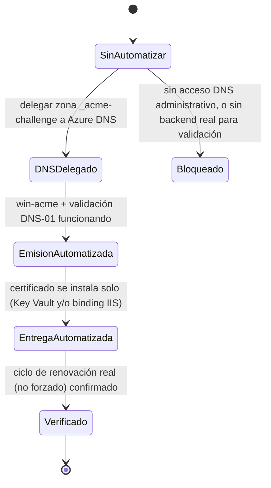

# Mapa de estados — Automatización de renovación SSL

Estado del proceso de automatización en sí (no de tickets Jira) para cada servicio público de SmartFran/Grido.

## Estado actual por servicio (actualizado 2026-09-13)

| Servicio | Hostname | Estado | Detalle |
|---|---|---|---|
| MobileAppService | `mobileservice.clubgrido.com.ar` | **EntregaAutomatizada** | DNS-01 + emisión + instalación verificadas en ambas VMs; falta confirmar un ciclo real no forzado |
| ClubSite AR — tramo público | `www.clubgrido.com.ar` (listener WAF) | **EntregaAutomatizada** | Certificado vía Key Vault, corte verificado sin downtime; falta confirmar ciclo real (recordatorio 2026-10-03) |
| ClubSite AR — tramo backend | `www.clubgrido.com.ar` (IIS, ambos nodos) | **EntregaAutomatizada** | Automatizado independientemente en `SFCG-CLUB-01` y `SFCG-CLUB-02`; falta confirmar ciclo real (mismo recordatorio) |
| ClubSite PY | `www.clubgrido.com.py` | **Bloqueado** | Sin acceso DNS administrativo al dominio `.com.py`; HTTP-01 tampoco viable (redirección sin backend real) |
| WebSite (GITIN-1771) | `gestion.clubgrido.com.ar` | **DNSDelegado** | Zona `_acme-challenge.gestion.clubgrido.com.ar` creada, SP con `DNS Zone Contributor`, delegación NS en GoDaddy confirmada y verificada externamente (2026-09-13). Falta: agregar `letsencrypt-isrg-root-x1` a `Backend_WebSite` (mismo gap que tuvo ClubSite AR) y correr win-acme en `SFCG-WSIT-01` (nodo único). Board Jira mostraba **Bloqueado** al iniciar este trabajo — sin blocker técnico identificado, no resuelto independientemente. |
| WebServiceV2 (GITIN-1772) | `webservicev2.smartfran.com` | **DNSDelegado** | Misma zona/rol/delegación que arriba, verificado (2026-09-13). Sin Gateway/Key Vault en este caso (LB L4 puro) — falta correr win-acme independientemente en `SFCG-WSV2-01` y `SFCG-WSV2-02` (cert propio por VM, como MobileAppService). |
| WebServiceCG (GITIN-1773) | `bot-security.smartfran.com` | **DNSDelegado** | Misma zona/rol/delegación, verificado (2026-09-13). Nodo único (`SFCG-WSCG-01`, detrás de `SFCG-WSCG-LB`, L4 puro). Certificado actual es un wildcard comercial pago (`*.smartfran.com`, Sectigo, vence 2027-03-28) — reemplazarlo tiene más alcance que los demás casos; falta confirmar si ese wildcard se usa en otros hosts antes de instalar win-acme. |

**Última actualización:** 2026-09-13. Seguimiento de tickets (no el objeto de este diagrama): [GITIN-1768](https://smartit-ar.atlassian.net/browse/GITIN-1768) (épica) y sus seis subtareas. Detalle completo de las tres automatizaciones en curso: `operations/events/20260913_automatizar_website/`, `operations/events/20260913_automatizar_webservicev2/`, `operations/events/20260913_automatizar_webservicecg/`.
