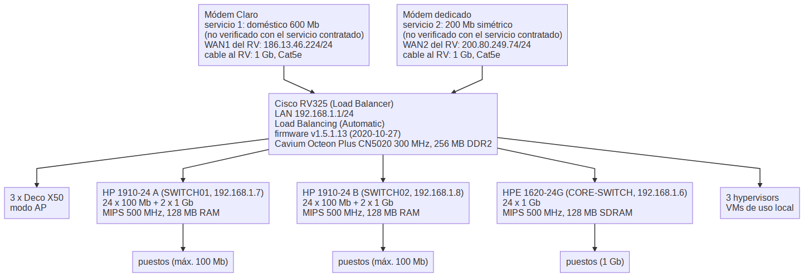

**Asunto:** Relevamiento de red de la oficina: hallazgos y recomendaciones

Ticket: https://smartit-ar.atlassian.net/browse/GITIN-2288

Hola,

Resumo el relevamiento de red de la oficina que realicé el 2026-10-22. Medí la velocidad de internet desde los módems, el router, los switches y el WiFi, leí la configuración del router y de los tres switches, y ejecuté una auditoría en tres notebooks. Todas las cifras son de mediciones individuales, hechas con solo dos personas en la oficina, es decir, sin la carga normal de uso.

## Mapa de red

Adjunto el mapa de la red como se encuentra hoy (`network-map.png`): los dos módems, el RV325, los tres switches, los 3 access points Deco X50 y los 3 hypervisors.

## Qué encontré

1. **Los dos servicios de internet entregan mucho más de lo que se ve en los puestos.** Conectado directo al módem, el servicio Claro dio 678 Mb/s de download y 381 de upload, y el servicio dedicado 369 y 187. Los anchos de banda de 600 y 200 Mb/s que figuran en el mapa no están verificados contra el servicio contratado.
2. **Los puestos cableados en dos de los tres switches tienen un tope de 100 Mb/s.** Una notebook con placa gigabit negoció 100 Mb/s en un puerto de ese switch, con varios cables y salteando la roseta de pared; la misma notebook llegó a 678 Mb/s en el módem. Los dos switches HP 1910-24 tienen, según listados de revendedores, 24 puertos de 10/100 y solo 2 de gigabit. El switch HPE 1620-24G sí negoció gigabit.
3. **El WiFi tiene velocidad suficiente, pero con variaciones de latency (jitter).** Las pruebas dieron entre 408 y 709 Mb/s de download. El jitter en WiFi fue alto en todas las configuraciones (entre 27 y 70 ms), también con los access points conectados directo al módem Claro, fuera del router. En cable, sin pasar por el router, el jitter fue bajo (hasta 15 ms); detrás del router llegó a 30 a 60 ms. No medí la causa de ninguno de los dos.
4. **El router muestra un comportamiento que no pude explicar.** Con las dos líneas conectadas, las descargas detrás del router fueron de 75 a 92 Mb/s; con solo Claro, dos equipos midieron 426 y 709 Mb/s. Cambiaron otras cosas entre una prueba y otra, así que no está establecido que la causa sea el load balancing entre las dos líneas. El router tiene firmware de 2020.
No hay evidencia, hasta ahora, de que el cableado sea la causa de los problemas: los contadores del router no muestran errores.

## Recomendaciones

Son propuestas, todavía no aprobadas ni decididas:

1. Relevar los puertos del switch 1620-24G (cuáles están en uso, qué hay conectado) y pasar a los puertos de 100 Mb/s los equipos que no necesitan gigabit, para liberar puertos gigabit a los puestos. No requiere compras.
2. Reemplazar los dos switches HP 1910-24 por switches administrables con monitoreo SNMP, con puertos de 1 Gb/s: un switch de 48 puertos (48 x 1 Gb/s) o dos de 24 puertos (2 x 24 x 1 Gb/s).
3. Es deseable reemplazar el router actual: es un equipo legacy, Cisco anunció su fin de venta en enero de 2020 y el fin del soporte en enero de 2021, y el firmware instalado es de octubre de 2020. Recomiendo MikroTik. El modelo se define por la capacidad que necesitan las dos líneas (600 y 200 Mb/s). Requisitos: load balancing por destino o con reglas, failover entre las líneas, VPN para el acceso remoto y soporte vigente.
4. Conectar los tres hypervisors al switch nuevo, y no al router.
5. Al reemplazar los equipos, cambiar los patch cords del backbone (la interconexión de switches, router, módems y access points) por patch cords Cat6. No encontré errores en los cables actuales: los contadores del router no muestran errores. El cambio da más margen y deja el cableado listo para velocidades mayores. Los cables hacia los puestos son Cat5e, que admiten 1 Gb/s hasta 100 m, así que alcanzan para puestos gigabit y no se reemplazan.
6. Exigir la conexión por cable en los puestos de trabajo y dejar el WiFi solo para las salas de reunión. Como llega una sola conexión por mesa y cada mesa tiene 4 personas con 4 a 6 dispositivos, cada mesa necesitaría un switch gigabit propio (uno de 8 puertos alcanza).
7. Reemplazar los adaptadores Ethernet USB 2.0, que limitan la conexión a 100 Mb/s, por adaptadores o bases gigabit USB 3.0 o USB-C para las notebooks sin puerto Ethernet. Para dimensionarlo hace falta saber cuántas notebooks no tienen puerto y qué versión de USB tiene cada una. El análisis y la compra son la tarea 5 de Ruben.
8. Aplicar con una política de Active Directory (GPO) la opción de Windows "Prevent Wi-Fi when on Ethernet", para que el WiFi se apague cuando la notebook se conecta por cable. Primero una prueba piloto en 3 a 5 notebooks. Conviene aplicarla después de reemplazar los adaptadores de 100 Mb/s: de lo contrario esas notebooks quedarían limitadas a 100 Mb/s, cuando el WiFi dio entre 408 y 709 Mb/s en las pruebas.
9. Analizar el cambio de los access points después de reemplazar los switches y el router, repitiendo entonces las mediciones de WiFi para ver si el jitter persiste. Para el WiFi de las salas de reunión, la opción recomendada son access points de la línea comercial Omada de TP-Link, administrados con el controller Omada instalado por software en una VM, sin comprar un controller dedicado (canales, potencia, límite de clientes, registros y monitoreo por equipo). Los Deco X50 instalados son la versión doméstica de los access points de TP-Link, según el fabricante; se administran solo desde una aplicación móvil y no ofrecen controller ni monitoreo por equipo que pueda confirmar. Es deseable unificar todos los access points en la misma línea. La cantidad de access points se define contando cuántas notebooks se conectan a Meet en cada sala.
10. Deseable: aislar el tráfico con VLAN (por ejemplo puestos, servidores e hypervisors, WiFi de salas e invitados, y administración de los equipos de red), con reglas en el router sobre qué puede comunicarse con qué. Requiere los switches administrables y el router de los puntos 2 y 3, y definir qué acceso necesitan los puestos a los hypervisors, porque las VMs se usan localmente.
11. Deseable: definir una nomenclatura para los cables y documentar la red. Etiquetar ambos extremos de cada cable (patch cords y bocas de pared) con un nombre que indique el origen y el destino, registrar qué puerto de qué switch corresponde a cada puesto y a cada equipo, y mantener actualizado un mapa de la red con los modelos, las direcciones y las velocidades de cada equipo. Requiere una etiquetadora, y el relevamiento de los puertos del switch 1620-24G es un primer insumo.
12. Agregar una herramienta de monitoreo por SNMP para los switches y el router: velocidad negociada de cada puerto, errores, CPU y memoria, estado de las dos líneas de internet, con alertas cuando un puerto negocie 100 Mb/s o una línea caiga. Hoy no hay monitoreo en la oficina; con SNMP se habrían visto los puertos de 100 Mb/s y las lecturas de memoria que no pudieron copiarse. Requiere los switches y el router administrables de los puntos 2 y 3.

## Pendientes asignados a Ruben

1. **Ejecutar el script de auditoría en cada equipo.** Listo cuando se haya ejecutado en todos los equipos de las personas que vienen a la oficina (unas 40; todavía no hay una lista de equipos para confirmar que no falta ninguno).
2. **Crear un ticket por cada caída del servicio de internet.** Una caída es un problema de internet que afecta a todos los usuarios, ya sea por ancho de banda bajo o por corte total. Listo cuando cada ticket esté creado y se haya enviado el correo a los responsables.
3. **Revisar los puertos del switch 1620-24G.** Listo cuando haya un informe con los puertos utilizables y con dónde está conectado cada puerto. Si el equipo conectado no necesita gigabit, pasarlo a un puerto de 100 Mb/s de los switches HP 1910-24. No mover los links hacia el router, los switches ni los access points.
4. **Averiguar con Administración qué servicio dedicado se paga.** Listo cuando se tenga el nombre del servicio y su ancho de banda (la medición en el módem, 369 Mb/s de download, supera lo que se había informado).
5. **Analizar el reemplazo de los adaptadores Ethernet USB (los de IoT).** Los adaptadores USB 2.0 disponibles limitan la conexión a 100 Mb/s; el análisis debe indicar con qué adaptadores o bases gigabit USB 3.0 o USB-C se reemplazan, cuántos hacen falta (cantidad de notebooks sin puerto Ethernet y versión de USB de cada una) y su costo. Listo cuando el reemplazo esté aprobado y enviado a compra.
6. **Revisar la configuración del WiFi (modo, canales, clientes por equipo)**, en tres partes. Listo cuando estén hechas las tres:
   - Con los resultados de la tarea 1, agrupar por BSSID para obtener el channel de cada access point y cuántas notebooks estaban conectadas a cada uno. Es una foto del momento en que se ejecutó el script en cada equipo.
   - En la aplicación Deco, para cada una de las 3 unidades, registrar el modo (AP o router), el ancho de channel y si el auto-channel está activado en cada banda, y el total de clientes conectados, incluidos los teléfonos.
   - Escanear el WiFi con `netsh wlan show networks mode=bssid` desde una notebook Windows, en una sala de reunión y en algunos puestos, para obtener por cada BSSID el channel, la señal y, si el access point lo informa, la cantidad de clientes y la utilización del channel. El ancho de channel no aparece en esa salida y se toma de la aplicación Deco. Guardar cada salida con un nombre distinto, sin los nombres de las redes vecinas.

Saludos,
