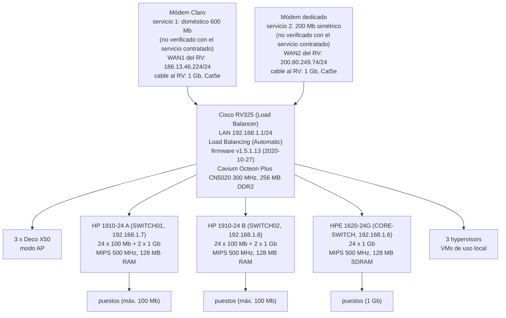

# Mapa de red de la oficina (borrador, 2026-10-22)

Relevamiento GITIN-2288. Estructura según lo relevado en la oficina; modelos, direcciones y velocidades según las páginas de los equipos pegadas durante el relevamiento. Es un borrador: los puntos de la tabla "Pendiente de confirmar" no están verificados.

## Diagrama



## Vista de texto

```
 [Módem Claro]      --1G--> WAN1 \
   servicio 1: 600 Mb             \
                                   [Cisco RV325 Load Balancer]
 [Módem dedicado]   --1G--> WAN2 /   LAN 192.168.1.1/24, Load Balancing (Auto)
   servicio 2: 200 Mb sim.           fw v1.5.1.13 (2020)
                                         |
        +--------------+-----------------+----------------+----------------+
        |              |                 |                |                |
   3 x Deco X50    1910-24 "A"      1910-24 "B"       1620-24G         3 x hypervisors
   (modo AP)       SWITCH01 .1.7    SWITCH02 .1.8     CORE-SWITCH .1.6 (VMs de uso local)
                   24 x 100 Mb      24 x 100 Mb       24 x 1 Gb
                   + 2 x 1 Gb       + 2 x 1 Gb        (sin puertos SFP / de uplink)
                        |                |                |
                  puestos (máx 100) puestos (máx 100) puestos (1 Gb)
```

## Datos del relevamiento que respaldan el mapa

| Equipo | Dato | Fuente |
|---|---|---|
| RV325 | firmware v1.5.1.13; LAN 192.168.1.1/24; Load Balancing automático; 14 puertos LAN gigabit | páginas del RV325 (Resumen del sistema, WAN dual, Estado del puerto) |
| WAN1 / WAN2 | 186.13.46.224/24 (Claro) y 200.80.249.74/24 (dedicado); ambos "Conectado" | Estadísticas del sistema del RV325 |
| SWITCH01 y SWITCH02 | HP 1910-24 JG538A, firmware 5.20.99 Release 1106; puertos Eth1/0/1-24 (10/100) y GE1/0/25-26 (gigabit) | Información del dispositivo; el listado de puertos de SWITCH01 |
| CORE-SWITCH | HPE 1620-24G JG913A, firmware 5.20.99 Release 1115; 24 puertos gigabit RJ-45 | Información del dispositivo |
| Decos | modo AP; los tres con cable | informado en el relevamiento |
| CPU/RAM de los switches | MIPS 500 MHz y 128 MB de RAM (1910-24 y 1620-24G; 32 MB de flash) | búsqueda web del 2026-10-23 |
| CPU/RAM del RV325 | Cavium Octeon Plus CN5020, 300 MHz, 256 MB DDR2, 64 MB de flash | texto de referencia del 2026-10-23, fuente no indicada; sin hoja de datos oficial: no verificado (la cantidad de núcleos que decía el texto no se incluye) |

## Pendiente de confirmar

Los números de puerto del RV325 no se incluyen (no importan por ahora).

| Punto | Estado |
|---|---|
| Cantidad de puestos por switch y de Decos por equipo | no indicado |
